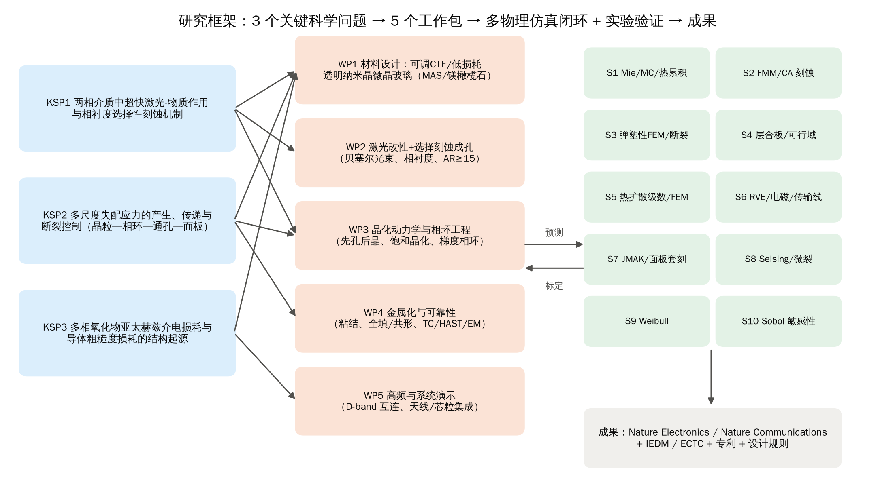
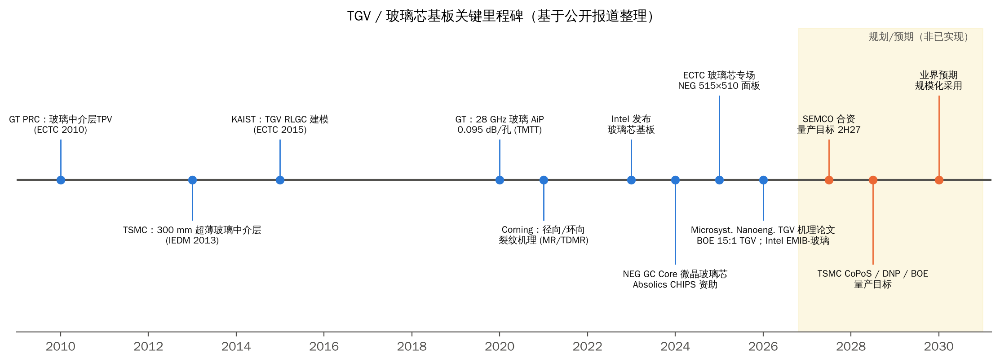
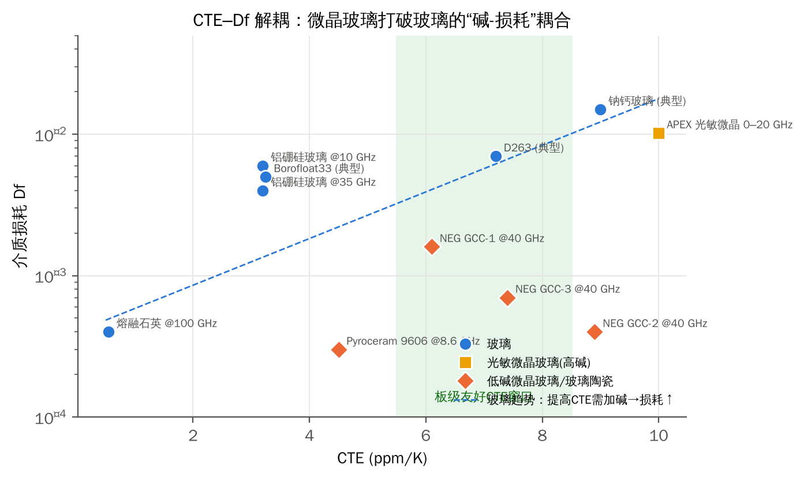

# 第1章 研究背景与意义
## 1.1 玻璃芯基板与 TGV：后摩尔时代封装的关键使能技术
AI 与高性能计算芯片正在快速转向芯粒（chiplet）异构集成。封装基板因此需要同时满足以下要求：更大尺寸（≥100 mm 封装体、510×515 mm 面板制造）、更细线宽（RDL L/S ≤ 5/5 µm）、更高互连密度（TGV 节距 < 100 µm）、更低高频损耗（D 波段及以上）、更小翘曲[1][53]。有机芯板（BT/ABF）在模量、平整度和尺寸稳定性上逐渐接近极限。玻璃凭借高模量、低粗糙度、可调 CTE、低介电损耗和面板级加工能力，被视为下一代芯板材料。玻璃通孔（Through-Glass Via, TGV）是实现玻璃芯上下层垂直互连的核心结构。

产业层面，Intel 于 2023 年 9 月宣布玻璃芯基板路线，称其互连密度可提升 10 倍、图形畸变降低 50%[1]。2025 年起有报道称 Intel 转向技术授权，自有产品部署推迟到约 2030 年[2][3]。SKC 旗下 Absolics 在美国佐治亚州建线并获 CHIPS 法案资助，但量产从 2024 年上半年一再推迟；早期试产曾每隔几天破损数百片面板[3][4]。三星电机与住友化学系企业合资，目标 2027 年下半年量产[8]。台积电 CoPoS 计划 2028 年下半年量产，玻璃芯规模化应用在 2030 年之后[7]。京东方 2026 年展示了 15:1 深宽比 TGV（1 mm 芯板、67 µm 孔径、24 层积层），通过 TC1000、uHAST 等可靠性测试，预计 2028 年左右量产[5]。TrendForce 统计，国内已有 18 家上市公司布局玻璃芯基板产业链[6]。

## 1.2 为什么研究微晶玻璃
上述推迟的共同根源是**玻璃本征脆性（K~IC~≈0.7–0.8 MPa·m^1/2^）与 Cu/玻璃热失配（17 vs 0.5–9 ppm/K）的叠加**。具体表现为：TGV 在退火升温时出现径向裂纹，降温时出现环向裂纹[18][19]；切割边缘出现 SeWaRe 侧壁裂纹；面板搬运时破损[4]；Cu 凸出与界面老化[21][22]。

微晶玻璃（玻璃陶瓷）是在玻璃基体中可控析出晶相得到的复相材料。它可以在同一体系内**解耦调控** CTE（约 0–11 ppm/K）、模量、断裂韧性（如二硅酸锂玻璃陶瓷从 0.8 提高到 3.05 MPa·m^1/2^）和介电损耗（低碱 MAS 体系 tanδ 可达 2–4×10^−4^）[36][37][40]。NEG 2024 年推出的 GC Core 以“CO₂ 激光无裂纹钻孔”为核心卖点：0.4 mm 厚板、Ø75 µm、节距 250 µm，钻孔速度大于 20,000 孔/分钟。2025 年已展示 515×510 mm 面板[31]。这说明微晶玻璃路线已具备产业可行性的初步证据。

然而，NEG 的 GC Core 本质上是玻璃粉与陶瓷粉的复合烧结体（LTCC 技术延伸）。孔径约 75–90 µm、深宽比约 5–6，远未达到 TGV 主流的 10–30 µm、AR ≥ 10。目前**还没有关于熔融法微晶玻璃（LAS、MAS、LS2 等）中超快激光 + 选择性刻蚀制备 TGV 的同行评议研究**（见第 3 章）。这正是本研究的切入点。

## 1.3 本报告的工作方法
本报告采用“文献—问题—方案—仿真—闭环—评估”的技术路线：
- **文献调研**：并行检索 2010–2026 年 TGV 工艺与产业化、可靠性与矛盾、微晶玻璃封装、射频与高影响力论文四个主题，形成 60 余条可追溯文献（见参考文献；未能核实全文的条目已注明）。
- **问题凝练**：从矛盾点和空白区出发，提炼 3 个关键科学问题和 6 条可证伪假设。
- **方案设计**：给出 5 个工作包的实验方案，包括配方、工艺窗口 DOE、表征方法、考核指标、风险预案与进度。
- **仿真验证**：自编和开源求解器结合，建立 S1–S10 共 10 个模块，覆盖 8 类物理场，并进行参数扫描、机理分析和全局敏感性分析。
- **闭环验证**：每个关键量都用解析解、独立数值方法、统计方法或文献实测中的至少两种交叉校核（第 7 章）。

# 第2章 TGV 研究现状
## 2.1 发展脉络
TGV 的学术研究始于约 2010 年，佐治亚理工封装研究中心（GT-PRC）在 ECTC 发表玻璃中介层通孔工作。2013 年，台积电在 IEDM 发表 300 mm 超薄玻璃中介层与高 Q 嵌入式螺旋电感[46]。此后研究经历了三个阶段：工艺开发（成孔、金属化，2010–2018）；射频与可靠性（2018–2023）；面板级产业化与机理深化（2023 至今）。2026 年，哈尔滨工业大学团队在 *Microsystems & Nanoengineering* 连续发表 TGV 残余应力演化、Cu 凸出机理与高温老化多尺度模拟论文[21][22]。这标志着 TGV 研究开始进入 Nature 合作期刊级别的“机理科学”阶段。

## 2.2 成孔技术
Table: TGV 成孔技术定量对比（数据来自公开文献与厂商资料）
| 方法 | 典型孔径 | 深宽比 | 锥角/侧壁 | 产能 | 主要局限 | 文献 |
|---|---|---|---|---|---|---|
| 激光诱导深刻蚀 LIDE（超快激光改性 + 湿刻） | ≥10 µm | 典型 10:1，最高 50:1 | 0.1–30°；侧壁粗糙度“仍在研究” | >5000 孔/s（写入） | 刻蚀耗时；HF 安全；玻璃成分敏感 | [9][14] |
| fs/ps 激光 + KOH/HF（实验室） | 10–100 µm | 可达 1:1000（通道） | KOH 选择比 955（HF 仅 66），添加剂可达约 3000 | 刻蚀 320–820 µm/h | 选择比依赖缺陷与纳米光栅 | [10][11][12] |
| 贝塞尔光束单脉冲/脉冲串 | 25–200 µm | >10 | KOH 选择比 2103:1 | 单次线聚焦 | 光束对散射敏感 | [11][12] |
| 飞秒脉冲串直接钻孔 | ≈10 µm | >1:80 | 零锥度（薄板） | 350 ms/孔；>10,000 孔/s（薄板） | 热影响区、碎屑 | [64] |
| CO₂ / UV 纳秒激光钻孔 | 25–100 µm | 3–6 | HAZ、微裂纹 | 很高 | 高 CTE 玻璃易裂（脉冲拖尾致 HAZ） | [60] |
| 光敏玻璃（FOTURAN/APEX） | 10–30 µm | 8–10（通孔），100（沟槽） | 侧壁粗糙 1–3 µm | 批量曝光 | Df≈0.01，高碱 | [15][33][34] |
| 电化学放电 ECDM / 喷砂 / DRIE | 50–350 µm | 约 11 / 低 / 低 | 过切大 / 锥形 / 0.5–1 µm/min | 低–中 | 难以细节距 | [14] |

业界已基本收敛到“超快激光改性 + 湿法刻蚀”（LIDE 类）作为大批量路线。但厂商宣称的“无微裂纹”与现场报道的加工微裂纹之间存在矛盾（见 3.1）。深宽比和锥角的物理上限由**刻蚀选择比 S** 决定，其标度关系由第 6.5 节仿真给出。

## 2.3 金属化与填充
Cu 与光滑玻璃之间缺少化学键合和机械锚固，附着力普遍偏低。文献报道的剥离强度相差近 10 倍：Ti/Cu 溅射约 1.5 N/cm，金属氧化物（ZnO 系）粘附层约 5–8 N/cm，热处理后可达约 10 N/cm[16][65]。填充方式分为两类。**全填充**电学、热学和气密性最好，但热失配应力最大。**共形（中空）填充**应力低，但工艺复杂、载流能力下降。Binghamton 大学的超共形“蝶形”填充在甲磺酸体系中实现 AR 6 填充 1 h、AR 10 填充 4 h[17]。小于 10 µm 的通孔在半米级面板上实现均匀金属化，仍是公开的难题[4]。

## 2.4 可靠性与热–力学问题
- **裂纹机理**。Corning 的 Okoro 等发现，全金属化熔融石英 TGV 的**径向裂纹产生于 400–420 °C 退火的升温阶段**（Cu 膨胀被约束，玻璃承受环向拉应力）[18]。同组 TDMR 论文指出，**环向裂纹产生于降温阶段**：Cu 层厚度小于约 12 µm 时裂纹消失，对应阈值应力约 140 MPa[19]。
- **Cu 凸出**。哈工大实测 400 °C 下凸出量从 5 min 的 0.61 µm 增至 30 min 的 1.21 µm[21]。京东方则把凸出归因于电镀添加剂杂质导致的空位聚集[29]。
- **玻璃种类效应**。Le & Choa 的 FEM 能量释放率排序为：熔融石英 > 铝硅 > 硼硅 > Gorilla > “陶瓷玻璃”，其中陶瓷玻璃比熔融石英低 4.4 倍[24]。这是微晶玻璃路线最直接的数值证据。
- **热循环**。GT/Corning 30 µm TPV 在 −55/125 °C 下多数通过 1000 次循环；哈工大热冲击 −55/150 °C 300 次即在 TGV–RDL 处开裂；板级上 CTE 9.8 的玻璃 BGA 寿命大于 5000 次，优于 CTE 3.8 的玻璃[27]。
- **Cu 本构**。独立 TGV-Cu 微柱压缩屈服强度为 123±7.85 MPa[20]，低于 TSV-Cu。

## 2.5 电学与射频性能
- **熔融石英**。NIST 片上测量 0.32–325 GHz：Dk = 3.87±0.03，几乎无色散[42]。
- **多组分玻璃**。损耗随频率近似线性上升，并随非桥氧和杂质增加[43]。ABF/玻璃/ABF 叠层的 Df 在 23/103/140 GHz 分别为 0.004/0.009/0.012。
- **实测互连损耗**。GT 在 100 µm 玻璃上测得 28 GHz 单孔损耗 0.095 dB[44]。UCSB/GT 的芯片嵌入玻璃封装在 110–170 GHz 下互连损耗小于 1.04 dB[45]。
- **侧壁粗糙度**。可控激光湿刻可把粗糙度从 1.257 µm 降到 25 nm。但 Hammerstad、Huray 等粗糙度模型尚未在 TGV 曲面侧壁上验证。
- **电源完整性**。低损耗玻璃对电源分配网络（PDN）谐振几乎没有阻尼，会引起 PDN 谐振问题[48]。

## 2.6 微晶玻璃/玻璃陶瓷封装基板现状
Table: 封装用微晶玻璃/玻璃陶瓷代表性材料（厂商与文献数据；“—”表示未公开）
| 材料 | CTE (ppm/K) | Dk / Df | 强度 / K~IC~ | 成孔方式与能力 | 文献 |
|---|---|---|---|---|---|
| NEG GC Core GCC-1 | 6.1 | 3.8 / 0.0016 @40 GHz | 150 MPa / — | CO₂ 激光，Ø75 µm，AR≈5 | [31] |
| NEG GC Core GCC-2 | 8.9 | 6.8 / 0.0004 @40 GHz | 260 MPa / — | 同上 | [31] |
| NEG GC Core GCC-3 | 7.4 | 7.6 / 0.0007 @40 GHz | 340 MPa / — | 同上 | [31] |
| 3DGS APEX（光敏 Li 硅酸盐） | 10 | 6.4 / 0.0102 | E=80 GPa | 10 µm 孔 / 20 µm 节距，AR≈10 | [33] |
| SCHOTT FOTURAN II | — | — | — | 选择比 30:1，粗糙度 1–3 µm | [34] |
| Hoya PEG3 | — | — | 高于普通玻璃 | 先刻孔 Ø50 µm，再 850 °C/2 h 全晶化 | [35] |
| Corning 9606 堇青石 | ≈4.5（未核实） | 5.5 / 0.0003 @8.6 GHz | — | 天线罩材料 | [36] |
| Zerodur（LAS，50–80 nm 晶粒） | 0±0.007 | — | K~IC~ 0.9 | 光学级透明 | [39] |
| 二硅酸锂 LS2 | ≈10–11 | — | K~IC~ 0.8→3.05 | 微米晶 | [37] |

**要点**：（1）NEG 专利 WO2026100288A1 要求晶相与玻璃相 CTE 之比为 2–8、晶相含量 2–50 wt%，说明可以利用晶–玻失配残余应力抑制钻孔裂纹[32]。第 6.7 节的 S8 模块给出了其力学解释。（2）Hoya PEG3 专利是目前唯一“先成孔后全晶化”的先例[35]，为本研究的 R2 路线提供了工艺可行性旁证。（3）飞秒激光可在 LAS 微晶玻璃体内将 β-锂霞石类纳米晶完全非晶化（Δn=−0.0035）[38]，但**非晶化径迹的刻蚀选择比从未被测量**。

## 2.7 高水平论文现状与启示
- **Nature 系 TGV 论文**。目前主要是 2026 年 *Microsystems & Nanoengineering* 的两篇机理论文[21][22]。其价值在于把纳米压痕应力、AFM 凸出测量与蠕变/相场模型结合，形成可用于设计的规则。
- **激光–玻璃领域**。高影响力工作的共同特征是“新物理机制 + 原子尺度证据 + 新能力”。例如：*Science* 2022 的玻璃内三维钙钛矿纳米晶直写[50]，*Nature Communications* 2024 用原子探针揭示氟促进的高光敏直写[51]，*Light: Science & Applications* 2026 的晶体内单脉冲非晶化光刻[52]。
- **IEDM 期待**。参照台积电 IEDM 2013[46]，IEDM 要求 300 mm 晶圆或面板级工艺、通孔链统计、TC/HAST 可靠性，以及 110–170 GHz 下 dB/孔、dB/mm 的基准数据。
- **空白**。尚未检索到以 TGV/玻璃中介层为射频平台的 *Nature Electronics* 或 *Nature Communications* 原创论文[53]。这既是挑战，也是机会：一项工作若能证明微晶玻璃以“相工程”同时提供玻璃做不到的能力（裂纹免疫 + CTE/损耗解耦 + 低粗糙度高 AR 成孔），并给出机理证据，就具备冲击 Nature 子刊的潜力。

# 第3章 矛盾点与研究空白
## 3.1 文献中的主要矛盾
Table: TGV 研究中的主要矛盾、证据与本研究的切入方式
| 矛盾 | 证据 A | 证据 B | 本研究的处理方式 |
|---|---|---|---|
| 哪种玻璃最抗裂 | FEM：高 CTE 玻璃 ERR 最低、熔融石英最高[24] | 芯片级匹配要求低 CTE（≈Si 2.6） | S4 多约束可行域：玻璃无鲁棒窗口，微晶玻璃以高 K~IC~ 打开窗口 |
| 升温还是降温开裂 | 升温径向裂纹[18] | 降温环向裂纹[19]；长时退火残余拉应力开裂[21] | S3 全历程弹塑性：升温控 σθ、降温控 σr 与凸出，两者都需控制 |
| 全填 vs 共形 | 薄 Cu（<12 µm）/中空最安全[19][23] | 全填通过 500–1000 次 TC，且气密性需要全填 | S3 策略对比：共形近壁 σθ −85%（全局 −54%）；中面残余 σr 随 Cu 壁厚单调上升（4/8/12 µm：18/49/75 MPa），与 Corning 趋势一致 → 以宽梯度相环补充 |
| Cu 凸出机理 | 应力驱动蠕变、30 min 内减速[21] | 添加剂杂质-空位聚集[29] | 弹塑性 FEM 给出无蠕变下限 0.40–0.69 µm，差值归因于蠕变/空位 |
| 翘曲收益 | Intel −50% 畸变[1]；TSMC 共面性 +16% | 板级仿真：玻璃芯翘曲反而更大[28] | 把“基板级”与“板级”指标分开，纳入同一可行域 |
| Dk/Df 数据 | 熔融石英 tanδ 约 4×10^−4^ @100 GHz | 铝硼硅约 0.006 @10 GHz，测量方法差异达 10–25% | 统一采用宽带多方法测试（WP5），并用 S6 的物理混合模型约束 |
| “无裂纹”宣称 | LIDE 宣称无微裂纹、无 HAZ[9] | 现场报道加工/划片微裂纹，宽约 100 nm、深 >100 µm | S1 散射/热累积与 S2 粗糙度模型，给出可检验的缺陷判据 |
| 产业就绪度 | 2023 年宣称“2020 年代后半期”量产 | 良率不足，Absolics 推迟，京东方试产良率未达标 | 可靠性与面板级尺寸稳定性列为 WP3/WP4 核心指标 |

## 3.2 研究空白
1. **熔融法微晶玻璃中的超快激光 + 选择性刻蚀 TGV**：未见同行评议报道。
2. **相衬度刻蚀**：激光非晶化径迹与晶相/残余玻璃相在 HF/KOH 中的刻蚀速率比未被测量，方向也不确定（FOTURAN 中晶相更快，LiNbO₃ 中非晶相更快）。
3. **晶粒尺寸/晶化率对贝塞尔光束焦线保真度、非线性吸收阈值和侧壁粗糙度的定量影响**：缺乏研究。
4. **工艺顺序**：“先孔后晶”中的晶化收缩、孔形畸变和面板级套刻误差没有数据（Hoya 专利除外）。
5. **激光局域晶化/非晶化“相环”**：作为 TGV 应力缓冲与 CTE 梯度结构，尚未被探索。
6. **金属化可靠性**：微晶玻璃 TGV 的 Cu 附着、热循环、Cu 凸出和电迁移可靠性数据为空白（NEG 将电镀与 RDL 列为“开发中”）。
7. **介电数据**：微晶玻璃芯在 40–110 GHz 以上的介电数据极少，介电损耗的结构起源（晶相、残余玻璃相、界面极化）没有定量模型。
8. **玻璃类基板的通用空白**：缺少 Weibull 强度数据库、羟基/湿度下的亚临界裂纹扩展数据、禁布区（KOZ）规则、热–力协同优化方法和专用鉴定标准。

## 3.3 机会：微晶玻璃能解决什么、会带来什么新问题
**能解决的问题**：断裂韧性提高 2–4 倍；CTE 可在 0–11 ppm/K 内调节而不显著增加碱含量（CTE 与 Df 解耦）；热导率可提高 2–3 倍；高温尺寸稳定性更好。

**会带来的新问题**：晶粒散射妨碍激光体内改性；两相刻蚀速率差导致粗糙度增大；晶化收缩影响面板套刻；晶–玻失配可能引发微裂纹；工艺链更长。

本研究把这些新问题本身作为科学问题，用“相工程”的思路**把劣势转化为新自由度**。例如，利用慢刻蚀晶相放大选择比；利用低模量、宽梯度、CTE 适配的相环降低失配应力。

{560}
