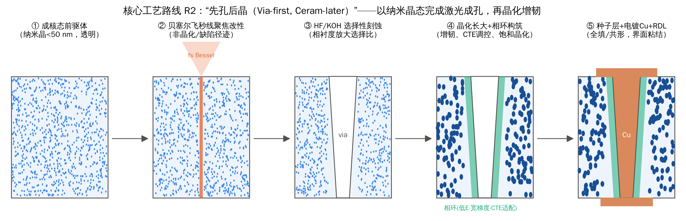
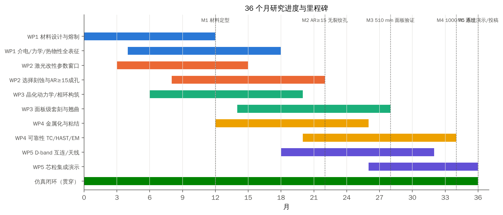

# 第4章 关键科学问题与总体研究思路
## 4.1 三个关键科学问题
> **KSP1｜两相介质中超快激光–物质相互作用与“相衬度”选择性刻蚀机制。** 纳米晶/残余玻璃两相结构如何影响非线性吸收、散射与贝塞尔焦线保真度？激光径迹的非晶化/缺陷化与晶相基体之间的化学溶解速率差（相衬度）能否放大选择比、并把侧壁粗糙度下限压低到晶粒尺度以下？

> **KSP2｜跨尺度失配应力的产生、传递与断裂控制。** 晶粒尺度（晶–玻 CTE 失配）、相环尺度（梯度相区）、通孔尺度（Cu–基板失配与界面粘结）、面板尺度（晶化收缩与积层翘曲）的应力如何耦合？能否通过相工程（晶相种类、晶化率、晶粒尺寸、梯度相环）实现“裂纹免疫”的 TGV？

> **KSP3｜多相氧化物亚太赫兹介电损耗与导体粗糙度损耗的结构起源。** 晶相声子限损耗、残余玻璃相（非桥氧/碱离子）损耗与界面极化，各自如何贡献 1–330 GHz 的 Df？刻蚀形成的曲面侧壁粗糙度如何决定 TGV 导体损耗？

## 4.2 可证伪的科学假设
Table: 研究假设与判据
| 编号 | 假设 | 可证伪判据（实验） | 仿真支撑 |
|---|---|---|---|
| H1 | 晶粒 d < d~max~(Δn) 时，贝塞尔焦线保真度与玻璃相当 | 500 µm 厚样品弹道透过 >0.9；焦线长度与直径偏差 <10% | S1：d~max~ = 43–274 nm |
| H2 | 激光非晶化径迹在晶相基体中的刻蚀选择比高于同组分玻璃 | S~GC~ / S~glass~ > 1.5（同一激光参数） | S2：放大因子 1.4–8 |
| H3 | 侧壁粗糙度 Rq ∝ 晶粒尺寸 d，比例系数由刻蚀速率比 ρ 决定 | 三种晶粒尺寸 AFM 侧壁 Rq 线性相关，R² > 0.9 | S2：Rq ≈ (0.8–5)·d |
| H4 | 低模量、宽度 ≈D/4、CTE 适配的梯度相环可使**全局**最大环向应力降低 >50% | 跨相环外缘的显微 Raman/同步辐射应变 mapping；400 °C 退火裂纹率 | S3 复算：−57%（GC-F、GC-C） |
| H5 | 微晶玻璃 TGV 在 400 °C 退火与 1000 次 TC 后无裂纹，玻璃对照组开裂 | 截面 SEM/声扫，裂纹率统计 | S3b/S9：d~c~ 提高 4–9 倍 |
| H6 | 低碱微晶玻璃在 CTE 6–8 ppm/K 时 Df(140 GHz) ≤ 1×10^−3^ | 开腔/片上 mTRL 实测 | S6：GC-F 介质线损耗约为铝硼硅玻璃的 1/11 |

## 4.3 总体技术路线
核心工艺路线 **R2“先孔后晶”**：在成核态（或纳米晶）前驱体中完成激光改性与刻蚀成孔，再通过晶化长大实现增韧和 CTE 调控，同时构筑梯度相环，最后金属化。对照路线为 **R1“先晶后孔”**（在完全晶化态中直接成孔）和 **R0 玻璃基准**（同组分母玻璃、商用无碱玻璃）。R2 化解了“透明–韧性悖论”（第 6.7 节），代价是晶化收缩，需以“饱和晶化”工艺加以控制（第 6.6 节）。

## 4.4 创新点
1. **新材料平台**：首次系统研究熔融法、可调 CTE、低损耗、纳米晶透明微晶玻璃作为 TGV 芯板，并提出镁橄榄石型（CTE 6–8.5 ppm/K、低 Df）和堇青石型（CTE 2.5–4 ppm/K、Si 匹配）两个材料族。
2. **新机制**：提出并验证“相衬度选择性刻蚀”——利用晶相/非晶径迹/残余玻璃三者的溶解速率差放大选择比，并建立粗糙度–晶粒尺寸标度律。
3. **新结构**：提出基体原生、不占 Cu 截面的梯度“相环”，并通过仿真给出设计目标：低模量（约 20 GPa）、宽度约 D/4、CTE 与基体适配（存在适中最优）。单纯的非晶化环或富晶环都会使应力升高；只看近壁应力会把收益夸大约一倍。
4. **新方法**：建立晶粒—相环—通孔—面板四尺度、热–力–断裂–电磁–刻蚀多物理场的闭环仿真体系，并开源给出 19 组交叉验证。
5. **新判据**：给出“任意裂纹止裂”临界孔径 d~c~ = 2(K~IC~/(β·F~max~·σ~θ~))^2^，以及 CTE 两难问题的多约束可行域。这些设计规则可直接用于工程。

# 第5章 实验研究方案（可操作性设计）
## 5.1 WP1 材料设计与制备（第 1–18 月）
**目标**：开发 2 个材料族、每族 3–4 个组分，晶化后满足：CTE 可调（GC-C 2.5–4、GC-F 6–8.5 ppm/K），K~IC~ ≥ 1.8 MPa·m^1/2^，Df(10 GHz) ≤ 1×10^−3^，成核态 500 µm 厚样品在 1030 nm 的透过率 ≥ 85%。

**组分设计**（摩尔分数，起点配方，以 DOE 微调）：
- **GC-F（镁橄榄石型）**：SiO₂ 45–52、MgO 25–32、Al₂O₃ 8–12、B₂O₃ 3–6、ZrO₂ 2–4（成核剂，避免使用 TiO₂ 以降低散射和损耗）、Y₂O₃/La₂O₃ 0–2（澄清与稳定），碱金属氧化物 < 0.5。
- **GC-C（堇青石/μ-堇青石型）**：SiO₂ 48–52、Al₂O₃ 24–28、MgO 13–16、ZrO₂ 3–5、ZnO 0–3、B₂O₃ 0–3。
- **对照**：同组分母玻璃（未晶化），以及商用无碱铝硼硅玻璃和熔融石英。

**制备工艺**：铂坩埚 1550–1620 °C 熔制 4 h（含机械搅拌和鼓泡澄清）→ 浇注 → 精密退火（Tg+10 °C，1 °C/min 降温）→ 切割、双面研磨抛光至 300/500 µm，Ra < 1 nm。小试 50×50 mm，中试 100×100 mm，WP3 阶段由合作厂进行 510×515 mm 压延/浮法试制。

**晶化制度 DOE**：成核温度 T~n~ ∈ {Tg+20, Tg+40, Tg+60} °C × 成核时间 {1, 2, 4} h；生长温度 T~c~ ∈ {T~p~−80, T~p~−60, T~p~−40} °C × 生长时间 {1, 2, 4, 8} h。采用 L16 正交表加中心复合设计，响应量为 X（晶化率）、d（晶粒尺寸）、透过率、CTE、E、K~IC~、Df。

**表征**：
- DSC：5/10/15/20/30 K/min，以 Kissinger/Ozawa 方法求 E~a~ 和 Avrami 指数 n（方法已用 S7 自洽验证，误差 0.09%）。
- 物相与微结构：XRD Rietveld（加内标定量晶化率）；TEM/STEM-EDS（晶粒尺寸分布、残余玻璃成分）；固体 NMR（^27^Al、^11^B 配位）；拉曼光谱。
- 光学：UV-Vis-NIR 透过与散射（积分球，得到弹道与漫射分量，对应 S1 的 Monte-Carlo 结果）。
- 热学与力学：热膨胀仪（−60–500 °C）；激光闪射热导率；纳米压痕和共振法测 E；SEPB/单边 V 型切口梁（SEVNB）测 K~IC~；环-环（ROR）双轴强度，每组 ≥ 30 片，做 Weibull 统计。

## 5.2 WP2 激光改性与选择性刻蚀成孔（第 3–22 月）
**设备**：1030 nm 飞秒激光器（脉宽 250 fs–10 ps 可调，单脉冲 ≥ 100 µJ，重频 1 kHz–2 MHz，支持 MHz/GHz 脉冲串），配贝塞尔光束整形（锥透镜 + 4f 系统，焦线 300–1000 µm），振镜 + 精密 XY 平台；对比 515 nm 二次谐波。
Table: WP2 激光–刻蚀工艺 DOE（每种材料 × 晶化状态各一套）
| 因素 | 水平 | 说明 |
|---|---|---|
| 材料状态 | 母玻璃 / 成核态 / 部分晶化（X≈0.3）/ 完全晶化 | 检验 H1、H2 |
| 脉冲能量 E~p~ | 5, 10, 20, 40 µJ（焦线归一化能量密度） | 非线性阈值与损伤 |
| 脉宽 | 0.3, 1, 3, 10 ps | 非晶化 vs 纳米光栅 |
| 脉冲串 | 单脉冲 / MHz 串 2–10 / GHz 串 | 热累积控制 |
| 重频 | 0.1, 0.5, 1, 2 MHz | 相环构筑（S1 窗口：≥0.5 MHz） |
| 刻蚀液 | 5–10% HF；8–10 M KOH @85–110 °C；KOH/IPA | 选择比与粗糙度 |
| 刻蚀方式 | 单面 / 双面 / 超声 / 兆声 | 锥角与沙漏形 |
**度量**：每组 ≥ 100 个孔，统计孔径、锥角、腰径（光学 + 截面 SEM）；聚焦离子束（FIB）截面加 AFM 测侧壁 Rq；Raman/PL 判断改性区结构（非晶化或缺陷）；TEM 观察径迹边界；用 HF/KOH 刻蚀速率台阶仪测 r~track~、r~glass~、r~crystal~，直接验证 H2/H3。
**考核**：孔径 20–50 µm，AR ≥ 15（双面），锥角 ≤ 3°，Rq ≤ 60 nm，无可见微裂纹（声扫 + 截面），写入速度 ≥ 1000 孔/s。

## 5.3 WP3 晶化动力学与相环工程（第 6–28 月）
1. **R2 先孔后晶**：成孔后的成核态样品按 S7 推荐的“饱和晶化”制度处理（保温到 X 平台区，|∂X/∂T| < 10^−3^/K）。测量孔径和孔位变化（坐标测量机 + 图像拼接，510 mm 面板 ≥ 2000 点），以及孔壁表面析晶层厚度（EBSD/TEM）。
2. **相环构筑**：利用 MHz 重频热累积，在孔周 5–20 µm 内形成可控相变区（S1 给出 E~p~–重频–环半径窗口）。三条子路线：
  - (a) 高 CTE 晶相（镁橄榄石/顽辉石）局域富集；
  - (b) 选择性浸出残余玻璃相，形成纳米多孔晶骨架，降低 E；
  - (c) 多孔骨架中渗入聚合物（聚酰亚胺/Parylene），提高韧性并密封。
  目标相环参数（来自 S3 复算）：内侧 E~c~ ≈ 20 GPa（≤ 50 GPa）；宽度 ≥ D/4（d = 50 µm 时 ≥ 12.5 µm）；α~c~ 与基体相当或适度上调（GC-C 可上调至约 9 ppm/K，GC-F 不宜再上调）。相环必须位于**刻蚀后孔壁之外**：激光热累积需改为环形扫描，或在刻蚀后从孔壁向外处理；子路线 (b) 浸出天然满足这一要求。子路线 (c) 的聚合物浸渗受热预算（Parylene/PI ≤ 320–350 °C）、吸湿和高 CTE 限制，优先改用 ALD 氧化物封孔。
3. **表征**：纳米压痕阵列 mapping（E、H 梯度）、显微 Raman（晶相与应力）、同步辐射微区 XRD/μ-Laue（应变张量 mapping）、DIC 原位热台（25–400 °C）。

## 5.4 WP4 金属化与可靠性（第 12–34 月）
**金属化**：PVD Ti/Cu（50/300 nm）与 ZnO 溶胶–凝胶粘附层 + 化学镀 Cu 两条路线；电镀包括全填（MSA 体系 + 加速剂/抑制剂/整平剂）和共形（5–10 µm）两种；退火温度 250/300/350/400 °C × 0.5/2 h。
**附着力**：90° 剥离（目标 ≥ 8 N/cm）、划痕测试、四点弯界面能（目标 G~ic~ ≥ 5 J/m²）。

**可靠性矩阵**：
- 温度循环：JESD22-A104 条件 B（−55/125 °C），1000/2000 次；
- 热冲击：−55/150 °C；
- 高加速应力：HAST（130 °C/85% RH，96 h）与 uHAST；
- 高温存储：HTSL（150 °C，1000 h）；
- 电迁移：J = 1–5 MA/cm²，T = 150–250 °C；
- 退火裂纹：退火后的裂纹率。

每组 ≥ 3 片 × 10 条菊花链（每链 ≥ 500 孔），失效判据为 ΔR > 10%。

**原位与失效分析**：显微 Raman 应力 mapping（借鉴 CuO 传感层法）、AFM 凸出测量、FIB-SEM/EBSD（Cu 晶粒演化）、声扫 C-SAM、X 射线 CT、全息断层扫描（holotomography）检测微裂纹。

**设计对照组**：实心 Cu、共形 Cu、2 µm 聚合物衬层、相环（3 种）× 3 种基板 × 2 种孔径（30/50 µm），共 36 组，直接对标 S3 的策略对比。

## 5.5 WP5 高频表征与系统演示（第 18–36 月）
- **材料介电**：分离介质谐振器（SPDR，1–15 GHz）、Fabry–Perot 开腔谐振器（20–110 GHz）、自由空间准光法（D 波段 110–170 GHz）、THz-TDS（0.2–3 THz）。三种以上方法在交叠频段互校，消除文献中 10–25% 的 tanδ 方法分散。
- **互连结构**：多线 TRL 校准的 CPW、GSG TGV 单孔/背靠背链（1/2/4/8 孔）、同轴 TGV（中心孔 + 环形接地孔阵列）、SIW。片上测试至 220 GHz（VNA + 扩频模块），用 T 矩阵法提取单孔参数，对标 GT 0.095 dB/孔 @28 GHz[44]、UCSB <1.04 dB/互连 @D-band[45]。
- **粗糙度–损耗专项**：在同一结构上制作 Rq = 25/60/150/500 nm 四档侧壁（通过晶粒尺寸和刻蚀参数控制），首次在 TGV 曲面上标定 Hammerstad/Groiss/Huray 模型。
- **系统演示**：在微晶玻璃芯上做 140 GHz 天线阵列封装（AiP），与 InP/SiGe 芯粒集成；完成 100×100 mm 芯粒中介层的翘曲与 TC 测试（对标京东方/Intel 公开指标）。

## 5.6 关键设备与平台
Table: 主要设备需求
| 类别 | 设备 | 用途 |
|---|---|---|
| 材料制备 | 高温熔制炉（1650 °C）、精密退火炉、晶化炉（±1 K 均匀性）、研磨抛光线 | WP1/WP3 |
| 激光 | 飞秒/皮秒激光器 + 贝塞尔整形 + 脉冲串模块；CO₂ 激光（对照） | WP2/WP3 |
| 刻蚀与金属化 | HF/KOH 湿法刻蚀台、PVD、化学镀/电镀线、CMP | WP2/WP4 |
| 表征 | XRD、TEM、FIB-SEM/EBSD、AFM、显微 Raman、纳米压痕、DSC/TMA、激光闪射、同步辐射机时 | 全部 |
| 可靠性 | 温循箱、HAST、电迁移测试台、四探针/菊花链测试 | WP4 |
| 高频 | VNA（≥ 67 GHz）+ 110–220 GHz 扩频模块、探针台、开腔谐振器、THz-TDS | WP5 |
| 计算 | 工作站集群（本报告代码可在 4 核/16 GB 机器上运行） | 全部 |

## 5.7 风险与对策
Table: 主要风险、量化早期预警指标与预案
| 风险 | 预警指标 | 预案 |
|---|---|---|
| R1 晶粒散射导致贝塞尔焦线失真 | 成核态 500 µm 透过 < 0.85 | 改用 R2（母玻璃态成孔）；降低 Δn（调整残余玻璃折射率）；改用 515 nm/多焦点 |
| R2 两相刻蚀粗糙度过大 | Rq > 150 nm | 减小晶粒（< 60 nm 时 Rq < 60 nm，见 S2）；后续短时 HF 抛光；以玻璃态成孔 |
| R3 晶化收缩致套刻超差 | 面板残余误差 > 2 µm | 饱和晶化 + 线性预补偿（S7）；先晶化后在完全晶化态做精密对位 |
| R4 晶–玻失配微裂纹 | 晶粒 > d~c~（GC-F 约 8 µm） | 控制晶粒 < 1 µm；调整晶/玻 CTE 比（S8） |
| R5 Cu 附着力不足 | 剥离 < 5 N/cm | ZnO/TiOx 粘附层；相环多孔锚固；等离子活化 |
| R6 Df 未达标 | Df(140 GHz) > 2×10^−3^ | 降低残余玻璃碱/硼含量；提高晶化率；改用堇青石型 |
| R7 面板级制造不可得 | 无法获得 510 mm 坯板 | 以 100–200 mm 方片完成科学验证；与玻璃厂合作 |
| R8 可靠性不达标 | TC1000 失效率 > 1% | 共形 + 相环组合；降低退火峰温至 300 °C（d~c~ 随温度变化，见 S3b） |

## 5.8 进度安排与里程碑

## 5.9 考核指标
Table: 量化考核指标（对标国际先进水平）
| 指标 | 本研究目标 | 当前国际水平（参考） |
|---|---|---|
| TGV 孔径 / 深宽比 | 20–30 µm / ≥ 15（300–500 µm 厚） | 玻璃 LIDE：10 µm、AR 10–50；NEG GC Core：75 µm、AR≈5 |
| 侧壁粗糙度 Rq | ≤ 60 nm | 光敏微晶玻璃 1–3 µm；玻璃可控刻蚀 25 nm |
| 断裂韧性 K~IC~ | ≥ 1.8 MPa·m^1/2^ | 玻璃 0.7–0.8 |
| 400 °C 退火后裂纹率 | 0（d = 50 µm 实心 Cu） | 熔融石英全金属化 TGV 出现径向裂纹 |
| 温循可靠性 | 2000 次（−55/125 °C）ΔR < 10% | 1000 次（多数通过） |
| Df @140 GHz | ≤ 1×10^−3^（GC-F，CTE 7 ppm/K） | 铝硼硅玻璃约 0.009–0.012 |
| 单孔损耗 @140 GHz | ≤ 0.1 dB（含过渡 ≤ 0.5 dB） | < 1.04 dB/互连（D 波段） |
| 面板残余套刻误差 | ≤ ±2 µm（510×515 mm） | — |
| 热导率 | ≥ 2.5 W/m·K | 玻璃 1.1–1.4 |
