# 第6章 仿真方案与结果：可行性分析、参数扫描与机理分析
## 6.1 仿真体系总览
仿真体系的设计原则有三条：（1）**每个关键量至少有两种独立方法**（解析/半解析、自编数值、开源数值、统计、文献实测）；（2）**由简到繁**，先用解析解标定数值方法，再用数值方法拓展到解析解无法覆盖的几何、非线性和多相结构；（3）**参数扫描 + 全局敏感性**，把“可行”定量化为设计窗口。全部代码用 Python 编写（NumPy/SciPy、scikit-fem、scikit-fmm、miepython、scikit-rf、SALib），保存在 tgv_glass_ceramic/sim/ 目录，可在 4 核/16 GB 环境下复现。

Table: 仿真模块、物理场、方法与交叉验证对象
| 模块 | 物理问题 | 主方法 | 交叉验证方法 | 服务于 |
|---|---|---|---|---|
| S1 | 纳米晶散射、光子输运、MHz 热累积 | Mie 理论、Monte-Carlo、线热源叠加 | Rayleigh 极限、Beer–Lambert、Crank–Nicolson 有限差分 | KSP1/H1、相环工艺 |
| S2 | 选择性刻蚀剖面、侧壁粗糙度、选择比 | 快速行进法（程函方程） | Huygens 解析锥角、随机元胞自动机、3D 校核 | KSP1/H2/H3 |
| S3 | 退火 + 热循环弹塑性热应力、Cu 凸出 | 自编轴对称 Q4-Bbar J2 随动硬化 FEM | GPS-Lamé 解析、scikit-fem P2 | KSP2/H4/H5 |
| S3b/S3c | 径向裂纹应力强度因子、止裂判据 | P2 平面应变 FEM（能量法 + 张开位移法） | Griffith 精确解、Tada 权函数 | KSP2/H5 |
| S4 | 积层翘曲、CTE 两难可行域 | 经典层合板理论 | 轴对称 P2 FEM | 系统集成 |
| S5 | 热点温升、热通孔 | 正交各向异性 Fourier–Bessel 级数 | 轴对称 P2 FEM | 热管理 |
| S6 | 介电均匀化、TGV 阻抗、插入损耗、粗糙度损耗 | 有限体积 RVE、P2 静电 FEM、传输线（scikit-rf） | Maxwell-Garnett/Bruggeman、双线精确解、Hammerstad vs Groiss | KSP3/H6 |
| S7 | 晶化动力学、面板套刻误差 | JMAK 非等温/等温 | Kissinger/Ozawa 反演、薄盘解析解 vs 平面应力 FEM | 工艺路线 R2 |
| S8 | 晶–玻失配残余应力、自发微裂 | Selsing 解析 + Davidge–Green 能量判据 | 轴对称 P2 FEM | 材料设计 |
| S9 | 孔壁断裂概率 | Weibull 最弱链（基于 S3 应力场） | 与 S3b 断裂力学判据互证 | 可靠性 |
| S10 | 全局敏感性 | Sobol 方差分解（SALib，4096×(D+2) 样本） | — | 实验优先级 |

## 6.2 S3 热–力：退火与热循环全过程弹塑性分析
**模型**：轴对称单胞（直径 d = 50 µm、板厚 300 µm、节距 150 µm，外边界径向位移耦合以模拟阵列）。Cu 采用 J2 弹塑性线性随动硬化本构：E = 110 GPa，σ~y~ 从 25 °C 的 125 MPa 线性降到 400 °C 的 50 MPa[20]，H = 1.5 GPa。载荷历程为退火 25→400→25 °C，再做 2 个 −55/125 °C 热循环。网格 2560 个 Q4-Bbar 单元；求解采用一致切线 Newton 迭代，并配合自适应步长二分，以保证反向屈服阶段收敛。

**验证**：在细长几何（h/a = 40）下，中面应力分别与广义平面应变 Lamé 解析解和 scikit-fem P2 独立求解器比较，最大相对偏差分别为 0.82% 和 0.036%（图 6-1）。

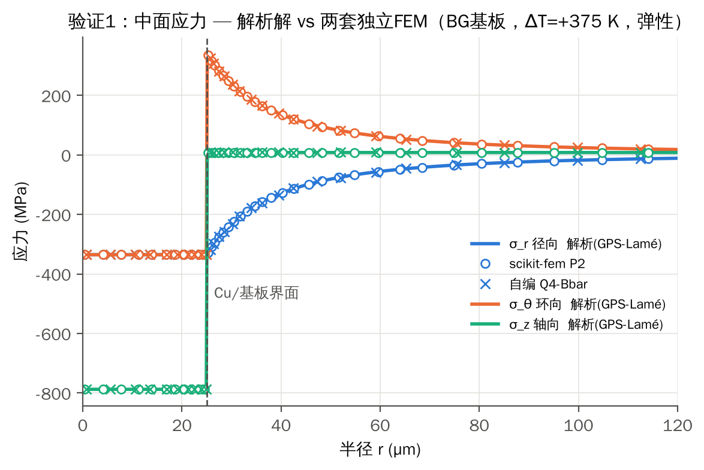{520}

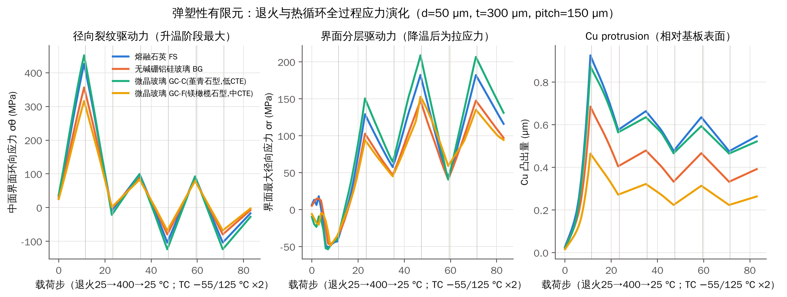

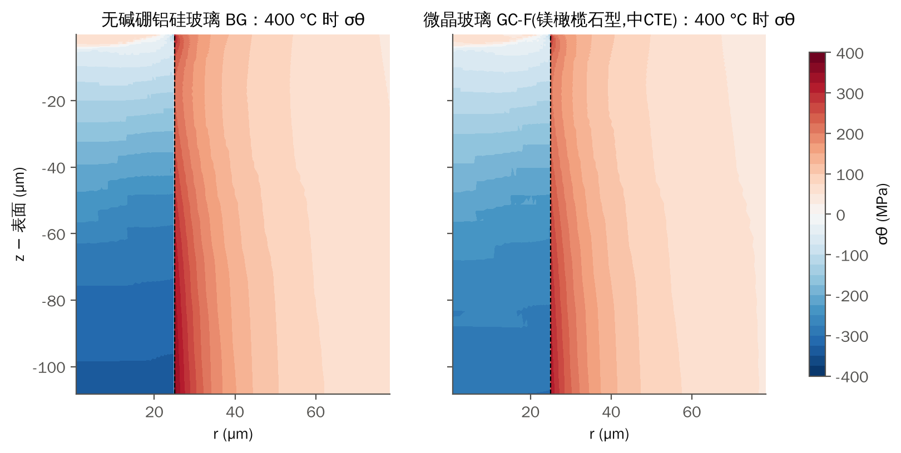{560}

Table: 四种基板的弹塑性 FEM 关键结果（d = 50 µm 实心 Cu，退火 400 °C）
| 指标 | 熔融石英 FS | 铝硼硅玻璃 BG | 微晶玻璃 GC-C | 微晶玻璃 GC-F |
|---|---|---|---|---|
| 400 °C 中面界面 σθ (MPa) | 426 | 356 | 451 | 316 |
| 基板内最大主应力 (MPa) | 490 | 412 | 513 | 353 |
| 退火后界面残余径向拉应力 (MPa) | 129 | 103 | 151 | 94 |
| 400 °C Cu 凸出 / 残余凸出 (µm) | 0.93 / 0.58 | 0.69 / 0.40 | 0.87 / 0.56 | 0.46 / 0.27 |
| 第 2 个热循环 Cu 累积塑性应变 | 4.9×10^−3^ | 4.0×10^−3^ | 1.3×10^−3^ | 1.0×10^−3^ |
| Coffin–Manson 估算寿命（次，指示性） | ≈4.7×10^3^ | ≈6.8×10^3^ | ≈4.3×10^4^ | ≈7.2×10^4^ |
| 断裂韧性 K~IC~ (MPa·m^1/2^) | 0.75 | 0.75 | 2.0 | 2.0 |

**机理分析**：
- **开裂发生在升温阶段**。升温时 Cu 芯中面处于近静水压应力状态（σr≈σθ≈−p），偏应力小，**塑性无法有效松弛**。因此环向拉应力在升温段达到峰值，与 Okoro 的“升温径向开裂”观测一致[18]。
- **降温后的残余量**。降温时孔口自由表面附近 Cu 先反向屈服，留下 90–150 MPa 的界面残余径向拉应力（分层驱动力）和 0.27–0.58 µm 的残余凸出，对应“降温环向开裂/分层”[19]。两种现象由同一弹塑性机制统一解释，3.1 节的“升温 vs 降温”矛盾由此化解。
- **与实测对标**。BG 在 400 °C 下的凸出量为 0.69 µm，与哈工大实测 0.61–1.21 µm（400 °C、5–30 min）[21]处于同一量级。本模型不含蠕变，是下限。差值（约 0.5 µm）可归因于时间相关蠕变和空位机制[29]，这也为 3.1 节的“凸出机理”矛盾给出定量分界。
- **基板参数的作用**。GC-C 模量较高（110 GPa）、CTE 较低，σθ 反而最高。GC-F 的 CTE 更高（7.5 ppm/K），失配降低，σθ 降低 11%（相对 BG），凸出降低 32%，Cu 循环塑性应变降低 75%。可见**单纯提高模量不利**，提高 CTE、降低失配更有效；微晶玻璃的真正优势来自 K~IC~，见 6.3 节。

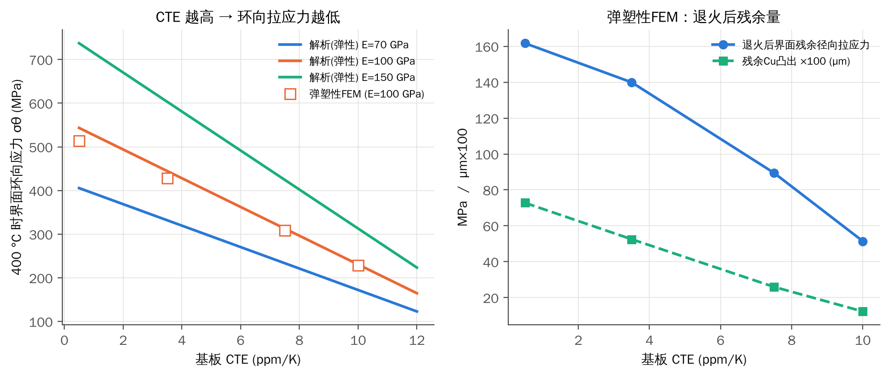

**应力缓释策略对比**（图 6-5）：
- **2 µm 聚合物衬层**：σθ 降低 32%，残余 σr 降低 31%。
- **8 µm 共形 Cu**：σθ 骤降 85%，但界面残余 σr 翻倍至 197 MPa（分层风险上升），且电/热/气密性下降。
- **激光非晶化玻璃相环**：σθ 升高 16%。玻璃相 CTE 低（4 ppm/K），加大了与 Cu 的失配。
- **富晶增强环**：模量升高，约束增强，σθ 升高 26%。
- **低模量、高 CTE 梯度相环**：σθ 降至 100 MPa（−68%），残余 σr 降低 13%，同时保留实心 Cu 的全部优点。

这一**反直觉的设计规律**由 6×5 参数的相环设计图确认（图 6-6）：环向应力等值线近似沿“E~c~ 降低、α~c~ 升高”方向下降。E~c~ ≤ 40–60 GPa 且 α~c~ ≥ 10–12 ppm/K 时，σθ 可降至 0–100 MPa。工艺实现路线见 5.3 节：激光热累积富集高 CTE 晶相，选择性浸出残余玻璃形成多孔骨架以降低模量，再渗入聚合物。

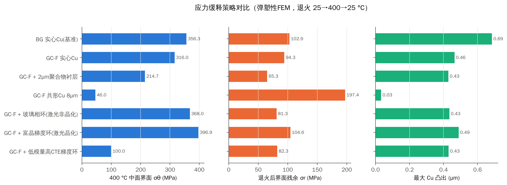

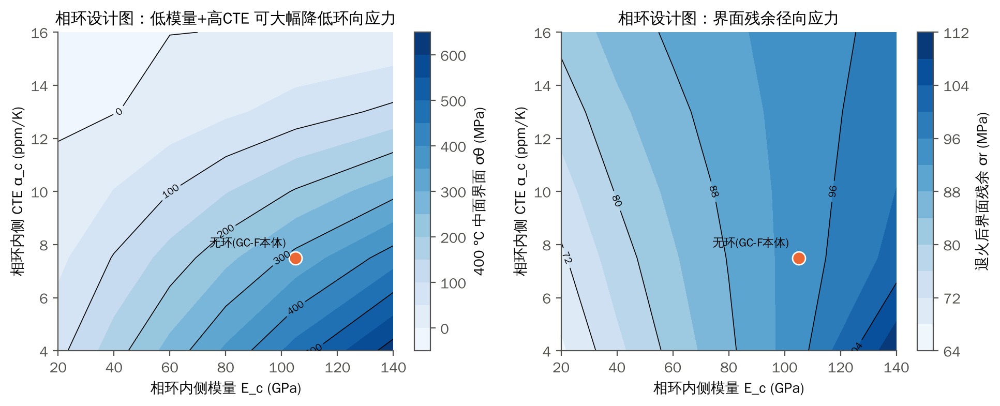

## 6.3 S3b/S3c/S9 断裂力学：止裂判据与概率可靠性
**问题**：孔壁附近衰减应力场 σθ(r) = σ0(a/r)² 中，径向裂纹的应力强度因子 K(c) 随裂纹长度 c 先升后降，存在极大值 K~max~ = F~max~·σ0·√a。若 K~max~ < K~IC~，任意长度的初始缺陷都会止裂。由此得到“无裂纹临界孔径”：

= d~c~ = 2·[K~IC~ / (β·F~max~·σ~θ~)]^2^

其中 β 为界面粘结修正（脱粘 β = 1，粘结 β < 1）。

**三层闭环验证**（图 6-7）：
- **算法基准**：均匀双轴应力场中心裂纹，FEM 能量法与 Griffith 精确解的偏差为 0.14%，张开位移法为 1.4%。
- **权函数检验**：自由孔加裂面载荷情形下，Tada 边裂纹权函数比精确 FEM 高约 30%。这说明权函数近似是**保守**的，原因是孔曲率效应。
- **界面粘结的影响**：Cu 芯与孔壁完全粘结时，两种 FEM 方法（能量法与张开位移法）相互一致（中位偏差 3.0%），K 降到自由孔/脱粘情形的 **67%**。

**机理含义**：界面粘结通过约束裂纹口张开来屏蔽裂纹。反过来，**界面脱粘会使开裂驱动力增大约 1.5 倍**。附着力与开裂因此是耦合问题，这解释了“附着力差的 TGV 更易开裂”的工程经验。按 d~c~ ∝ 1/β² 计算，界面完全粘结可使临界孔径提高约 2.2 倍。

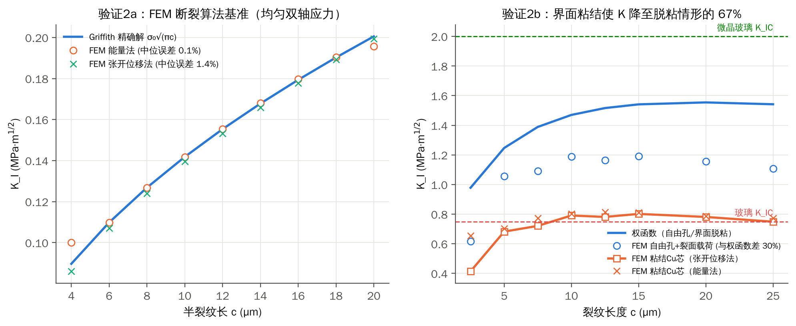

**设计图**（图 6-8，采用保守权函数 F~max~ = 0.885，β = 1）：400 °C 退火时，熔融石英 d~c~ = 8.2 µm，BG 12.0 µm，GC-C 49.5 µm，GC-F 107 µm。也就是说，**主流 10–100 µm 孔径的 TGV 在玻璃中无法保证止裂，在 GC-F 中全部可保证止裂**。若改用精确 FEM 的 F~max~（去除权函数约 30% 的保守量），d~c~ 还可再放大约 1.7 倍。退火温度降到 300 °C 时，BG 的 d~c~ 约 22 µm，仍偏小。

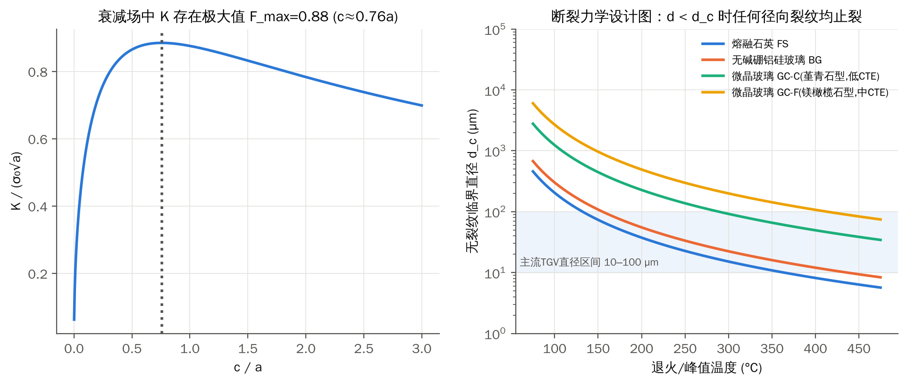

**Weibull 概率校核（S9）**：以 S3 的弹塑性孔壁环向应力场做表面最弱链积分。参数为：玻璃 m = 8、σ0 = 250 MPa；微晶玻璃 m = 15、σ0 = 400 MPa（参考面积 1 mm²，属假设值，需由 WP1 的 ROR 实验替换）。结果见下表与图 6-9。

Table: 单孔孔壁断裂概率（d = 50 µm）
| 峰值温度 | 熔融石英 | 铝硼硅玻璃 | GC-C | GC-F |
|---|---|---|---|---|
| 250 °C | 4.8×10^−2^ | 1.2×10^−2^ | 2.0×10^−4^ | 1.1×10^−6^ |
| 300 °C | 0.20 | 5.2×10^−2^ | 3.0×10^−3^ | 1.3×10^−5^ |
| 400 °C | 0.84 | 0.37 | 0.14 | 7.9×10^−4^ |

概率判据与断裂力学判据给出**一致的排序**（FS > BG > GC-C > GC-F），从统计与确定性两个角度互证。对含 10^5^–10^6^ 孔的面板，玻璃方案需要把峰值温度压到 250 °C 以下，并配合缓释结构；GC-F 在 300 °C 退火下的面板级失效期望约为 1–13 个孔。叠加相环方案（σθ 降低 68%，P_f 按 (σ/σ0)^m^ 下降数个量级）后，可实现面板级无失效。

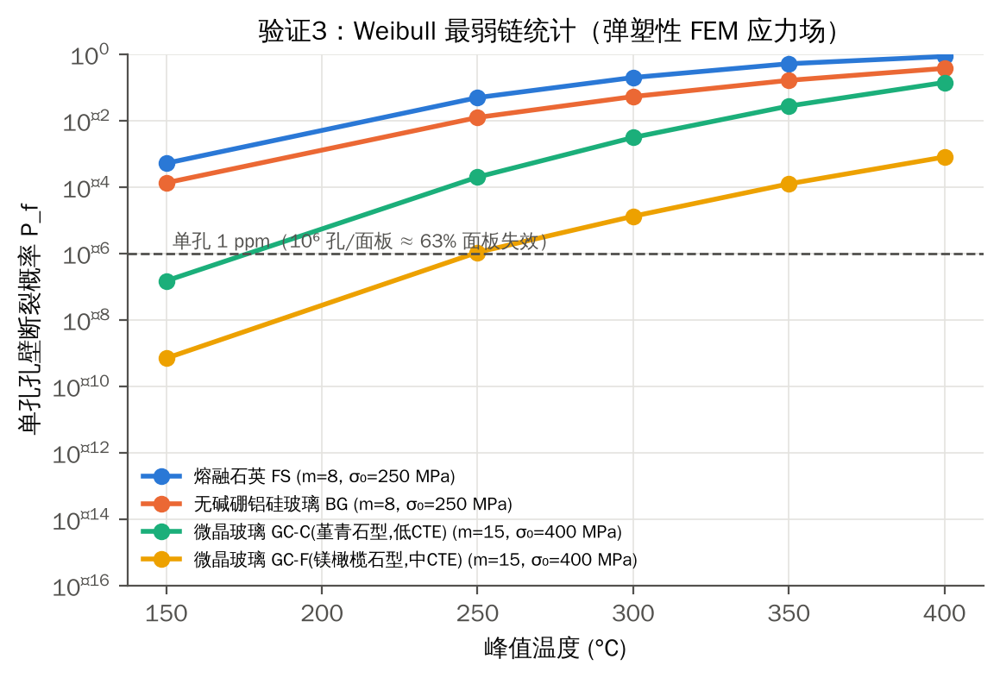{520}

## 6.4 S4 翘曲与 CTE 两难的定量求解
**翘曲验证**：以“3+1 非对称积层 + 芯板”层合板理论计算的曲率，与轴对称 P2 FEM 的偏差 ≤ 0.14%（BG/GC-C/GC-F/有机四种芯板）。在 400 µm 芯板上，GC-F 的翘曲约为 BG 的 60%（模量更高、与积层的 CTE 差更小）。
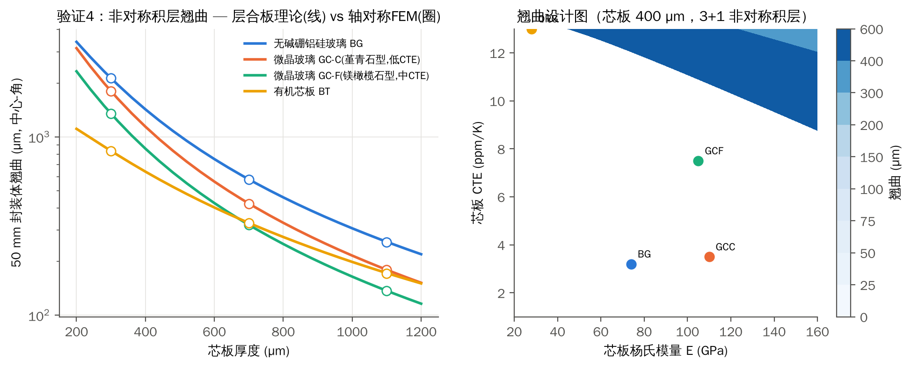

**CTE 两难可行域**：联合四个约束求解（表 6-4），扫描芯板 CTE（1–13 ppm/K）× 封装体尺寸（10–80 mm）。
Table: 可行域分析的约束与假设
| 约束 | 判据 | 主要假设 |
|---|---|---|
| 芯片级 CPI | 有效 CTE 与 Si 的差 ≤ 有机芯板基准的 50% | 3+3 积层，Cu 含量 20%/30%，有机基准 α~eff~ = 15.0 ppm/K |
| 板级 BGA | Engelmaier 寿命 ≥ 1000 次（0/100 °C） | 焊点高 0.4 mm，板级底填/角部加固系数 0.2，DNP = 0.707B |
| 翘曲 | w(B) ≤ 0.0035B（类 JEITA） | 层压 ΔT = −125 K |
| TGV 无裂纹 | β·F~max~·σθ·√a < K~IC~ | d = 50 µm，退火 350 °C，β = 1（局部脱粘最坏情形） |
**结论**（图 6-11）：在“局部脱粘”的鲁棒判据下，玻璃芯在任何 CTE 与尺寸组合下都无法同时满足四个约束：低 CTE 侧被 TGV 开裂限制，高 CTE 侧被芯片级 CPI 限制。即使界面完全粘结，玻璃也只有 5–7 ppm/K 的窄窗口，而这一 CTE 区间的玻璃需要高碱成分，Df 随之显著上升（图 3-1）。微晶玻璃芯的可行域为 **CTE ≈ 1.1–7.3 ppm/K、封装体尺寸 ≤ 53 mm**，而且可以用低碱组分实现低 Df。这是微晶玻璃“化解 CTE 两难”的定量证据。

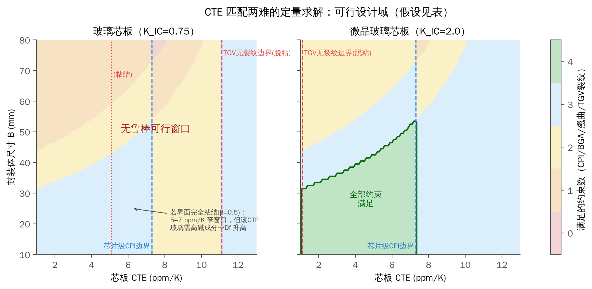

## 6.5 S1 激光–物质相互作用：透明性判据与相环工艺窗口
**散射验证**：x < 0.1 时，Rayleigh 近似与 Mie 精确解的偏差 < 0.4%（图 6-12 左）。**透明性判据**：独立散射近似（保守）下，要求 500 µm 厚、晶化率 0.5 的样品在 1030 nm 处弹道透过率 > 0.9，允许的最大晶粒直径为：堇青石型（Δn ≈ 0.01）274 nm，β-石英型（Δn ≈ 0.015）190 nm，镁橄榄石型（Δn ≈ 0.12）仅 43 nm（考虑 Percus–Yevick 相关散射修正后的乐观值为 72 nm）。成核剂 ZrTiO₄ 若长到 25 nm、含量 3 vol%，单独即可造成 3% 的散射损失，因此**成核剂尺寸也必须控制在约 10 nm**。

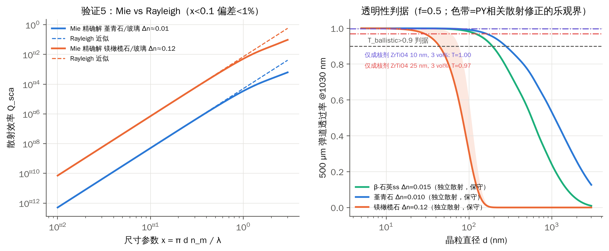

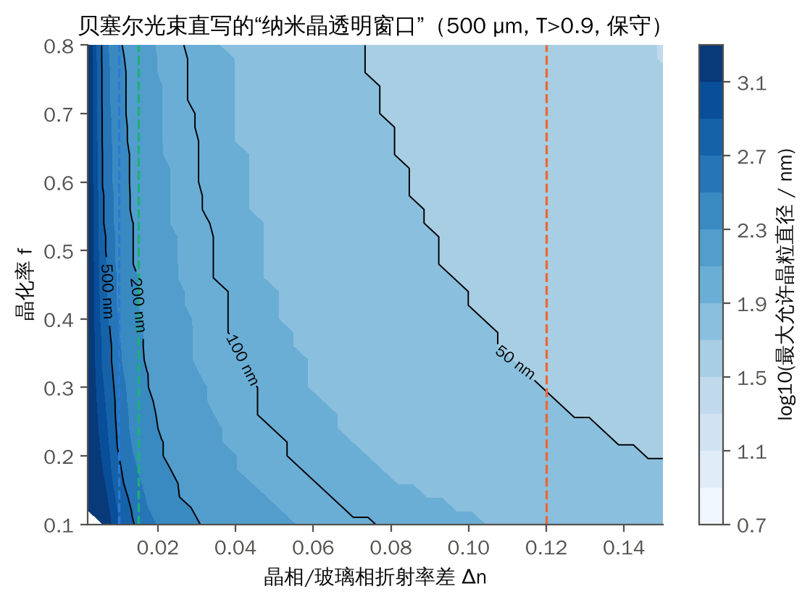{520}

**光子输运验证**：Monte-Carlo（2×10^5^ 光子，Henyey–Greenstein 相函数，g 由 Mie 计算）得到的弹道透过与 Beer–Lambert 解析解的偏差 ≤ 0.7%。MC 还给出漫射透过分量（16–62%）。这部分能量会在焦线外形成背景沉积，是潜在的附带损伤源，可用 WP1 积分球测量直接对标。

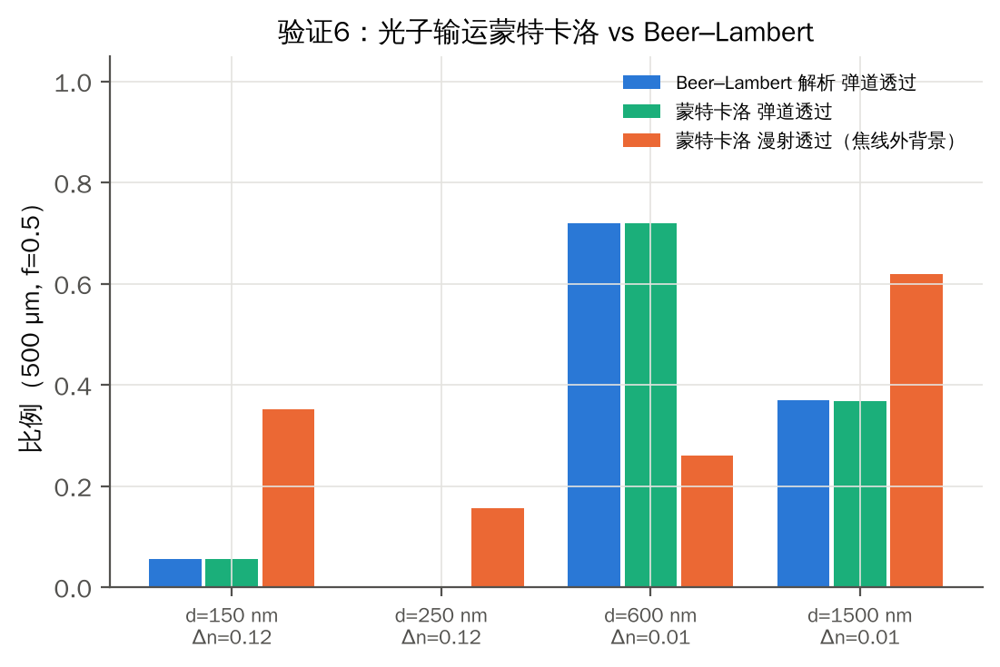{500}

**热累积与相环窗口**：高斯线热源叠加解析解与 Crank–Nicolson 有限差分的最大偏差为 0.98%（图 6-15 左）。在 k = 2 W/m·K 的微晶玻璃中，**热累积存在重复频率阈值，约 0.2–1 MHz（脉冲能量越低，阈值越高）**。在 E~p~ = 5–20 µJ、重复频率 1–6 MHz 范围内，“持续高于晶化起始温度”的相环半径可在 5–19 µm 之间连续调节，瞬态熔化（非晶化）区半径为 2–15 µm。这为 5.3 节的相环构筑给出了可直接执行的工艺窗口。

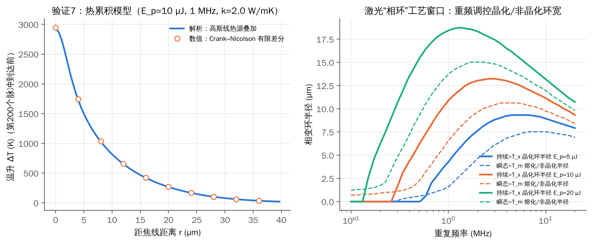

## 6.6 S2 选择性刻蚀：选择比–深宽比标度律与粗糙度机理
**剖面与锥角验证**：二维程函方程快速行进法（FMM）得到的单面刻蚀剖面锥角，与 Huygens 包络解析解 tanθ = 1/√(S²−1) 的中位偏差为 0.10%（S = 10–300）。由此导出**选择比–深宽比标度律** AR ≈ (1 − D~b~/D~t~)·S/2（单面）；双面刻蚀可加倍。若要求 D~b~/D~t~ ≥ 0.8 且 AR ≥ 15，单面刻蚀需要 S ≥ 150，双面需要 S ≥ 75。文献中 KOH 选择比 955–2103 足以满足[10][11]，HF 的 66 则不足。

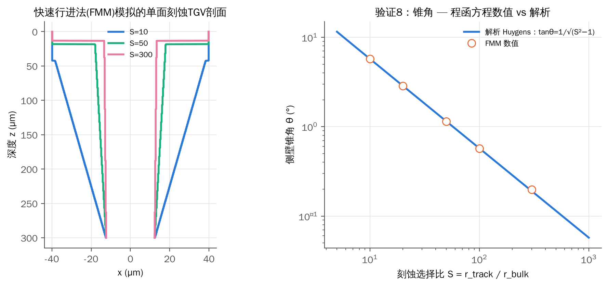
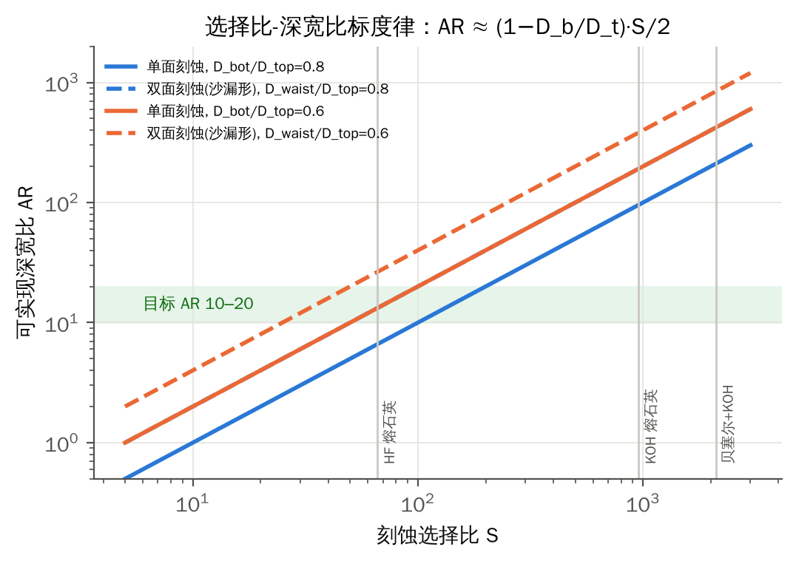{460}

**粗糙度机理**：两相微结构（布尔圆盘模型，晶化率 0.5，对数正态粒径）中，刻蚀前沿在快刻蚀玻璃相通道中“超前”，形成与晶粒尺寸相关的粗糙界面。确定性 FMM 与随机元胞自动机（CA）给出一致的标度，中位偏差 5.5%，表现为 **Rq ≈ k(ρ)·d**：
- ρ = r~g~/r~c~ = 3 时，k ≈ 0.7–0.8；
- ρ = 10 时，k ≈ 1.5–2.7；
- ρ = 30 时，k 约为 2–5（前进 0.6–0.8 µm 时）。

晶粒 30–60 nm、ρ ≤ 3 时，Rq ≈ 23–51 nm，处于 D 波段导体损耗的“粗糙度拐点”（约 50–150 nm）以下（见 6.9 节）。

**选择比放大**：慢刻蚀晶相基体降低了体相等效刻蚀速率。对激光非晶化径迹（刻蚀速率按玻璃计）而言，选择比因此被放大：二维时，f = 0.5 放大 1.1–2.2 倍，f = 0.7–0.8 放大 1.4–8.7 倍。三维校核（120³ 体素）在 f = 0.5–0.8 时为 1.4–8.2 倍，量级一致。由此形成可检验的设计权衡：ρ 越大，选择比放大越强，但粗糙度也越大。最优点约为 **ρ ≈ 3–10、晶粒 ≤ 60 nm、晶化率 0.6–0.7**。

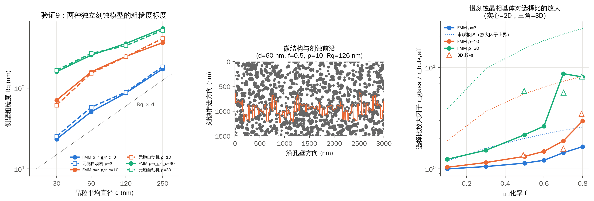

## 6.7 S7 晶化动力学与面板级尺寸控制
**方法自洽验证**：用 JMAK（E~a~ = 400 kJ/mol，n = 3）生成 5–30 K/min 的合成 DSC 曲线，再用 Kissinger 法反演得到 E~a~ = 399.6 kJ/mol（误差 0.09%），Ozawa 法误差 0.18%。这证明 WP1 拟采用的数据分析流程本身无系统偏差。
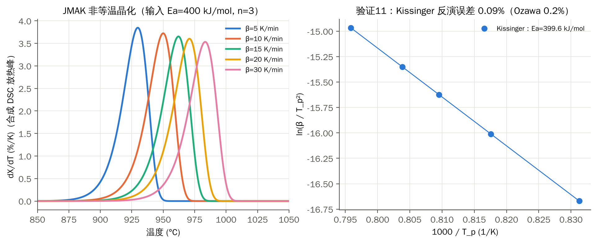

**饱和晶化策略**：等温晶化中，晶化率对炉温的敏感度 |∂X/∂T| 在 X ≈ 0.3–0.7 时最大，进入平台区后下降数个量级（图 6-20）。
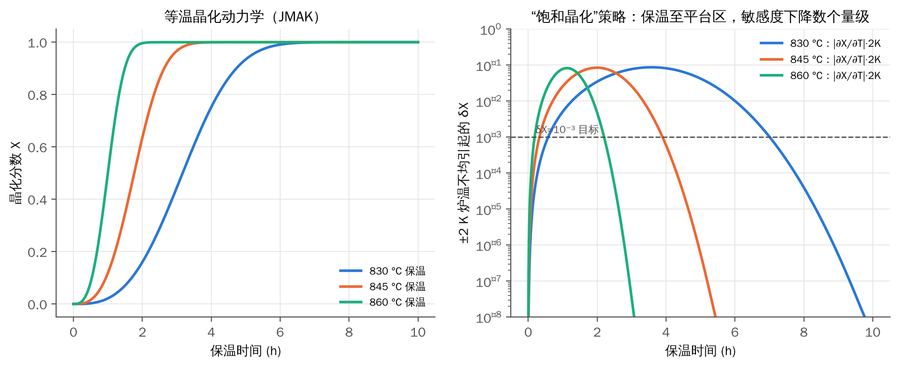

**面板套刻误差**：在 510×515 mm 面板上施加中心高、边缘低的抛物线炉温不均匀（±1/2/5 K），晶化收缩取 0.5%（假设值，待 WP3 实测）。平面应力 FEM 先经薄盘本征应变解析解验证（偏差 0.004%），再扣除线性缩放与刚体运动（设计预补偿）后计算残余套刻误差：
- 845 °C 保温 2 h 时：±2 K 炉温对应 38 µm，±5 K 对应 92 µm；
- 保温 ≥ 4 h 后：±2 K 对应 0.3 µm，±5 K 对应 1.4 µm；
- 保温 ≥ 6 h 后：所有工况均小于 0.01 µm。

**结论**：“先孔后晶”路线的面板级套刻风险，可以通过“饱和晶化 + 线性预补偿”控制在 ±2 µm 以内。这是 R2 路线可行性的关键量化证据。

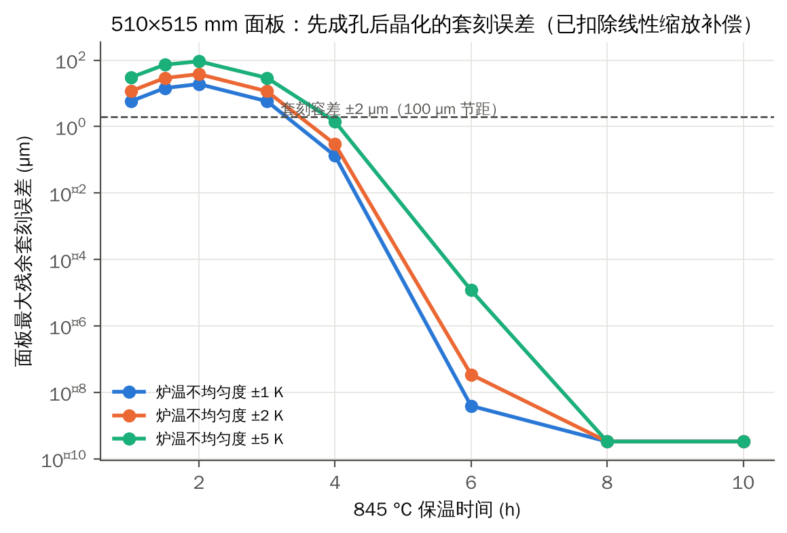{500}

## 6.8 S8 微结构残余应力与“透明–韧性”悖论
**验证**：单晶粒（球）嵌于残余玻璃基体，从 750 °C 冷却到室温，Selsing 解析解与轴对称 FEM 的基体应力偏差 < 0.1%。

**机理**：
- **堇青石型**（α~c~/α~g~ = 0.45）：晶粒受压（−142 MPa），基体环向**拉应力** +71 MPa，存在基体径向微裂风险。
- **镁橄榄石型**（α~c~/α~g~ = 2.45）：界面径向拉应力 +409 MPa（脱粘风险），基体环向**压应力** −204 MPa。后者可使裂纹偏转、闭合，从而增韧。这正好解释了 NEG 专利要求 α~c~/α~g~ = 2–8 的力学原因[32]。

**Davidge–Green 能量判据**：自发微裂的临界晶粒直径，镁橄榄石型为 8.3 µm，堇青石型为 58 µm。因此 R2 路线的晶粒生长上限应控制在约 1–3 µm。
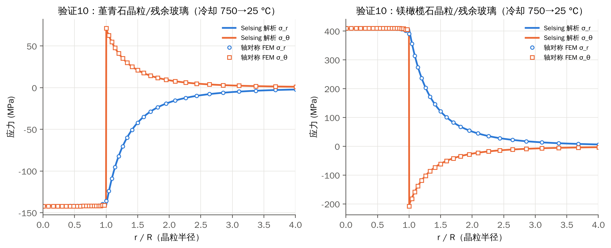
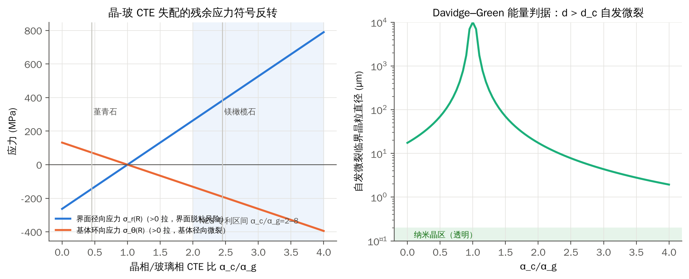

**悖论与化解**：散射要求晶粒 d ≲ 50–270 nm；以 Zerodur（d ≈ 65 nm，K~IC~ = 0.9）和 LS2（d ≈ 微米，K~IC~ ≈ 3）为锚点的唯象模型表明，K~IC~ ≥ 2.0 需要 d ≳ 1–2 µm。二者在同一状态下不可兼得（图 6-24）。R2 路线**在纳米晶态完成激光成孔（阶段 A），在晶化长大后获得韧性（阶段 B）**，从时间维度上解耦了这对矛盾。这是本研究工艺设计的核心科学依据。
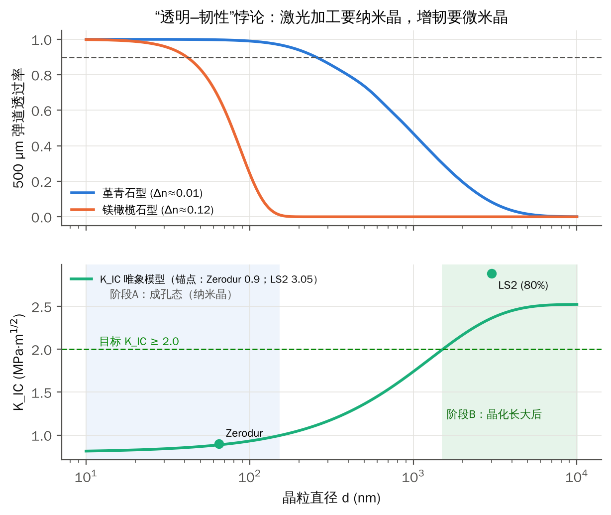{520}

## 6.9 S5 热管理
正交各向异性 Fourier–Bessel 级数精确解与轴对称 P2 FEM 的偏差 ≤ 0.06%。工况：5 W、Ø5 mm 热点，400 µm 芯板，底面 h = 5000 W/m²K。热点最高温升如下：
- **无热通孔**：有机芯板 220 K，BG 143 K，FS 124 K，GC-C 83 K，GC-F 77 K。微晶玻璃比 BG 低 42–46%。
- **热通孔 Cu 面积分数 φ ≥ 5%**：各基板温升收敛到 54–56 K，差异 < 4%。此时热通孔主导散热，基板热导率的作用变小。

热–力协同 Pareto 图（图 6-25 右）显示：增大 φ 降低温升，但通孔环向应力随之上升。以 σθ/K~IC~ 衡量，微晶玻璃的 Pareto 前沿整体位于玻璃左下方。也就是说，**同样温升下开裂风险更低，或同样开裂风险下可布置更多热通孔**。
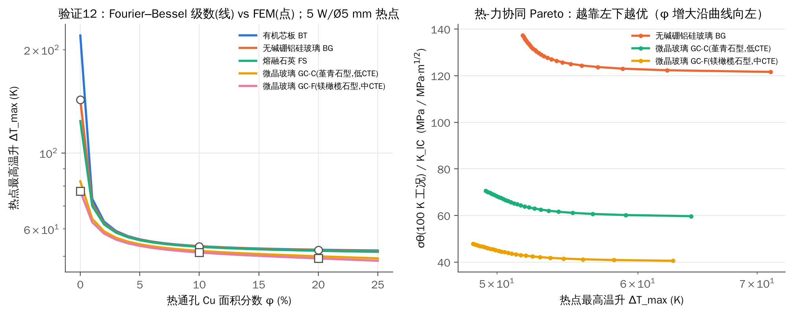

## 6.10 S6 电学与射频
**介电均匀化验证**：二维随机圆盘 RVE（有限体积，256²）的复介电常数，与 2D Maxwell-Garnett 的偏差 ≤ 0.013%。同一偏微分方程也验证了热导率均匀化。按三维 Maxwell-Garnett 预测：镁橄榄石型晶化率 0.5 时 Dk ≈ 6.1、Df ≈ 7.8×10^−4^（10 GHz）；晶化率 0.7 时 Df ≈ 5×10^−4^。**晶化率是 Df 的主控变量，残余玻璃相是损耗的主要来源**。
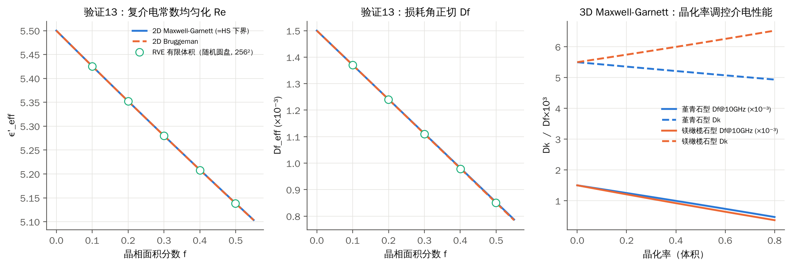

**TGV 阻抗**：P2 静电 FEM 计算的差分 TGV 对电容，与双线精确解 C = πε/arccosh(s/d) 的偏差 ≤ 0.21%。由 GSG 阻抗设计图得到 50 Ω 所需的节距/孔径比：FS 1.98，BG 2.30，GC-C 2.33，GC-F 2.70。
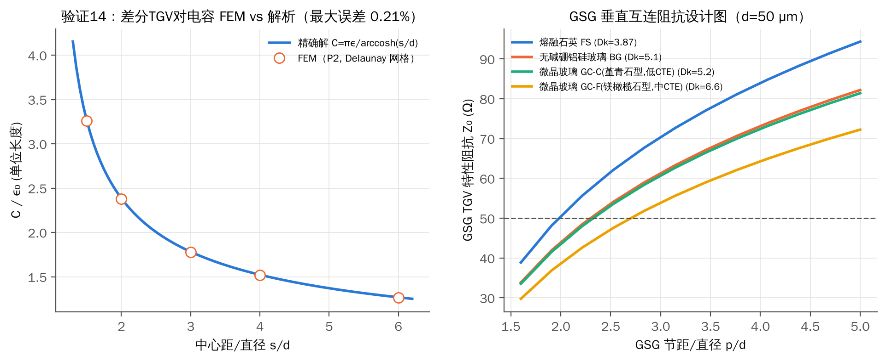

**插入损耗**（50 Ω 匹配设计，t = 300 µm，d = 50 µm，Rq = 50 nm；tanδ 频散指数按文献数据标定）：
Table: 单个 GSG TGV 耗散损耗（dB）与 140 GHz 基板介质损耗（dB/mm）
| 基板 | 28 GHz | 77 GHz | 140 GHz | 220 GHz | α~d~ @140 GHz (dB/mm) |
|---|---|---|---|---|---|
| 熔融石英 FS | 0.013 | 0.024 | 0.034 | 0.046 | 0.011 |
| 铝硼硅玻璃 BG | 0.025 | 0.068 | 0.132 | 0.226 | 0.34 |
| 微晶玻璃 GC-C | 0.014 | 0.025 | 0.038 | 0.053 | 0.028 |
| 微晶玻璃 GC-F | 0.013 | 0.025 | 0.038 | 0.054 | 0.032 |
| 有机 BT | 0.024 | 0.061 | 0.110 | 0.177 | 0.27 |
**解读**：微晶玻璃的单孔损耗与熔融石英相当，约为 BG 的 29%。介质线损耗约为 BG 的 1/11 到 1/12，这对毫米级传输线、天线和 SIW 更为关键。在 100 µm 厚 BG 上，28 GHz 单孔“管身”损耗为 0.008 dB，比 GT 实测（0.095 dB/孔，含焊盘过渡）[44]低一个量级。这说明实测损耗主要来自过渡结构的不连续性；Sobol 分析（6.11 节）也得出同样结论。

**粗糙度**：140 GHz 下 Cu 趋肤深度约 0.18 µm。Hammerstad 与 Groiss 两模型给出的粗糙度因子 K~r~ 为：Rq = 25 nm 时 1.00–1.02，60 nm 时 1.10–1.15，150 nm 时 1.49–1.64，≥ 500 nm 时趋于 2。两模型在 150 nm 附近分歧最大（约 10%），这正是 WP5 需要用实验标定的区间。
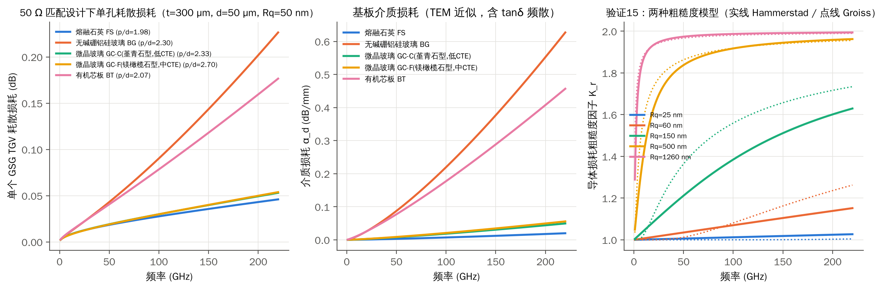

## 6.11 S10 全局敏感性分析
采用 Sobol 方差分解，每个模型 4096×(D+2) 个样本。
- **模型 A：裂纹安全裕度 log10(K~IC~/K~max~)**。总效应指数排序为：断裂韧性 K~IC~ 0.32 > 孔径 0.22 > 峰值温度 0.14 > 基板 CTE 0.11 > 基板模量 0.10 ≈ 界面粘结 β 0.10。Cu 物性与泊松比的影响可忽略。**这表明提高 K~IC~（即材料选择微晶玻璃）是保证可靠性的第一杠杆，其效果超过工艺参数优化。**
- **模型 B：140 GHz 单孔插损**。节距/孔径比（阻抗匹配）0.36 > 板厚 0.27 > Df 0.20 > Dk 0.14 > 损耗频散指数 0.11 > 孔径 0.05 > 粗糙度 0.007。**单孔损耗主要由阻抗设计决定；材料 Df 主要影响长传输线；单孔层面的粗糙度贡献很小。** 粗糙度的影响主要体现在 RDL 长线上。

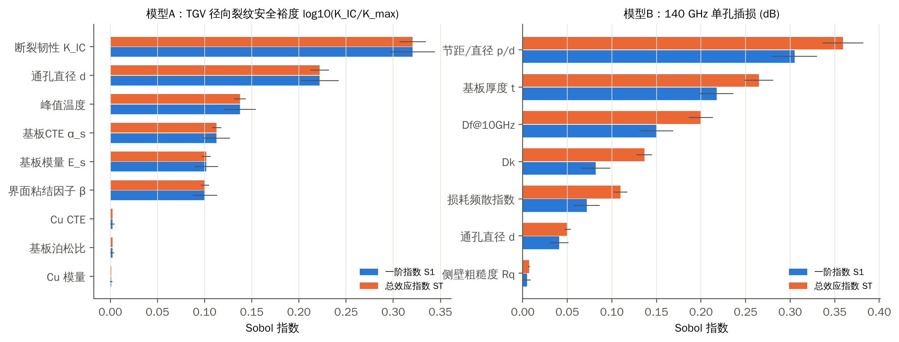
