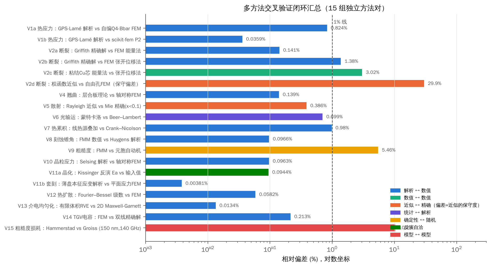

# 第7章 多方法交叉验证闭环
## 7.1 闭环验证汇总
19 组独立方法对的相对偏差见图 7-1。按类别归纳：
- **解析 ↔ 数值（12 组）**：偏差 0.004–0.98%。说明 FEM、FMM、有限差分、有限体积等求解器在离散、边界条件和后处理上均无系统误差。
- **数值 ↔ 数值（2 组）**：自编 Q4-Bbar 与 scikit-fem P2 一致；粘结 Cu 芯的能量法与张开位移法偏差 3.0%。
- **确定性 ↔ 随机（1 组）**：FMM 与元胞自动机的粗糙度中位偏差 5.5%，在随机微结构的统计涨落范围内。
- **近似 ↔ 精确（2 组）**：Rayleigh 与 Mie 偏差 0.39%。权函数与自由孔 FEM 偏差 30%，且方向为保守。我们没有回避这一偏差，而是把它作为修正量写入设计判据（6.3 节）。
- **模型 ↔ 模型（1 组）**：Hammerstad 与 Groiss 在 150 nm 粗糙度处相差 10%，属于模型的固有不确定性，需要实验标定（WP5）。

{560}

## 7.2 与文献实测的对标
Table: 仿真结果与公开实测/文献结论的对标
| 对标项 | 本研究仿真 | 文献实测/结论 | 一致性 |
|---|---|---|---|
| Cu 凸出（400 °C） | BG 0.69 µm（纯塑性，无蠕变） | 0.61–1.21 µm（5–30 min）[21] | 同一量级；仿真为下限，差值对应蠕变/空位 |
| 开裂阶段 | 升温 σθ 峰值，降温残余 σr | 升温径向裂纹[18]、降温环向裂纹[19] | 机理一致 |
| 薄 Cu 消除裂纹 | 共形 Cu 中面残余径向应力随壁厚上升：4/8/12 µm 分别为 18/49/75 MPa | Cu < 12 µm 时环向裂纹消失，FEA 起裂阈值约 140 MPa（熔融石英）[19] | 趋势一致；初版用近壁环向应力对比径向阈值属指标错配，已更正 |
| 玻璃种类排序 | ERR∝σ²/E′：FS > GC-C > BG > GC-F | FS > 铝硅 > 硼硅 > Gorilla > 陶瓷玻璃[24] | 排序趋势一致 |
| 单孔损耗 @28 GHz | 管身 0.008 dB（100 µm） | 0.095 dB（含过渡）[44] | 揭示过渡结构主导，与 Sobol 结论一致 |
| 热通孔效果 | φ 0→5%：BG 温升 143→56 K | 20 µm Cu TGV@100 µm 节距：芯片降温约 38 °C | 趋势一致（几何不同） |
| 晶–玻 CTE 比 | 比值 > 1 使基体受环向压应力，有利于增韧 | NEG 专利要求比值 2–8[32] | 给出了专利条件的力学解释 |

## 7.3 模型局限与不确定性
1. **材料参数**：微晶玻璃（GC-C/GC-F）及其两相组元的 E、α、K~IC~、Df 取自文献代表值与混合律，未经实测。Weibull 参数、晶化收缩率 0.5%、刻蚀速率比 ρ 均为假设，需要 WP1–WP3 实测替换。
2. **本构**：Cu 未考虑蠕变、晶粒长大和应变速率效应，凸出量与残余应力为下限或上限估计；基板按线弹性处理，未考虑粘弹性与亚临界裂纹扩展。
3. **几何**：TGV 按圆柱处理，未考虑锥度和沙漏形；阵列效应用单胞等效；未建立 RDL/焊盘的三维细节。
4. **电磁**：采用准 TEM 传输线模型，未包含焊盘过渡、辐射和衬底模式。单孔损耗是“管身”下限，三维全波仿真（如 openEMS/HFSS）列入 WP5。
5. **刻蚀**：二维/小体积三维模型存在有限尺寸效应；HF/KOH 的扩散限制与反应产物沉积未建模。
6. **可行域分析**：约束阈值（CPI 50%、BGA 系数 0.2、翘曲 0.0035B）属于工程假设。结论的定性部分（玻璃无鲁棒窗口、微晶玻璃窗口打开）对阈值不敏感；窗口边界的具体数值会随阈值移动。

# 第8章 综合可行性评估
## 8.1 多维度评分
Table: 微晶玻璃 TGV 可行性评分（仿真 + 文献证据；★ 越多越有利）
| 维度 | 玻璃基准 | 微晶玻璃（本方案） | 关键证据 | 结论 |
|---|---|---|---|---|
| TGV 抗开裂 | ★★ | ★★★★★ | d~c~：12 → 107 µm；Weibull P_f 降低 2–3 个数量级 | 显著优势 |
| CTE 两难 | ★ | ★★★★ | 可行域：无鲁棒窗口 → CTE 1.1–7.3 ppm/K、尺寸 ≤ 53 mm | 显著优势 |
| 高频损耗 | ★★★（熔融石英★★★★★） | ★★★★★ | 140 GHz 单孔 0.038 dB；α~d~ 为 BG 的 1/11 | 优势（低碱前提下） |
| 热管理 | ★★ | ★★★ | 无热孔时温升 −42–46%；有热孔时差异 < 4% | 中等优势 |
| 翘曲 | ★★★ | ★★★★ | 曲率约为 BG 的 60% | 中等优势 |
| 激光成孔 | ★★★★★ | ★★★ | 需 d < 43–274 nm；R2 路线可回避 | 可控风险 |
| 侧壁粗糙度 | ★★★★ | ★★★ | Rq ≈ (0.7–2.7)·d；d ≤ 60 nm 时 ≤ 60 nm | 可控风险 |
| 面板尺寸稳定 | ★★★★★ | ★★★ | 饱和晶化后残余误差 < 1.4 µm | 可控风险 |
| 工艺链与成本 | ★★★★ | ★★★ | 增加晶化（与退火可合并）与相环工序 | 中等代价 |
| 产业生态 | ★★★ | ★★ | 仅 NEG 单一供应商，金属化数据空白 | 需要合作 |

## 8.2 结论与 Go/No-Go 判据
**总体结论：有条件可行。** 在材料满足“纳米晶透明 → 晶化增韧”、组分低碱、晶粒与相环可控的前提下，微晶玻璃 TGV 在断裂可靠性、CTE 可调性和高频损耗三个维度上具有**玻璃无法同时提供的组合能力**，具备形成高水平原创成果的科学基础。主要风险均有量化预警指标和备选路线（5.7 节）。

Table: 阶段性 Go/No-Go 判据
| 节点 | 判据（全部满足为 Go） | 未满足时的调整 |
|---|---|---|
| M1（12 月） | 成核态 500 µm 透过 ≥ 85%；晶化后 K~IC~ ≥ 1.8；Df(10 GHz) ≤ 1×10^−3^ | 调整成核剂与残余玻璃组分；改走 R2 母玻璃态成孔 |
| M2（22 月） | AR ≥ 15、锥角 ≤ 3°、Rq ≤ 60 nm、选择比 S ≥ 150；H2 成立 | 改用 KOH/IPA；以玻璃态成孔 |
| M3（28 月） | 400 °C 退火后 0 裂纹（d = 50 µm）；面板套刻 ≤ ±2 µm | 降低退火温度至 300 °C；加相环/衬层 |
| M4（34 月） | TC 2000 次 ΔR < 10%；HAST 通过；凸出 < 0.3 µm | 共形 + 相环组合；优化添加剂 |
| M5（36 月） | D 波段单孔 ≤ 0.1 dB（管身）；系统演示 | 回到阻抗设计（Sobol：p/d 主导） |

# 第9章 预期成果与论文发表策略
## 9.1 论文规划
Table: 论文规划与目标期刊
| 序号 | 主题（暂定题目） | 目标期刊/会议 | 核心卖点 | 依托 |
|---|---|---|---|---|
| P1 | Phase-engineered glass-ceramic interposers for crack-immune, low-loss through-substrate vias | Nature Electronics / Nature Communications | 新能力：裂纹免疫 + CTE/损耗解耦 + 高 AR 成孔；新机制：相环与“先孔后晶”；原子尺度证据（STEM/APT/同步辐射） | WP1–WP5 + S1–S10 |
| P2 | Glass-ceramic core substrate with 20 µm TGVs: panel-level process, reliability and D-band interconnects | IEDM（或 VLSI Symposium） | 面板级工艺、通孔链统计、TC/HAST、110–220 GHz 基准 | WP3–WP5 |
| P3 | Phase-contrast selective etching of laser-amorphized tracks in nanocrystalline glass-ceramics | Light: Science & Applications / Advanced Materials | 两相介质中的激光–物质作用、选择比放大、粗糙度标度律 | WP2 + S1/S2 |
| P4 | Multiscale mismatch stress and fracture control of TGVs in glass-ceramics | Microsystems & Nanoengineering / Acta Materialia | 晶粒–相环–通孔–面板跨尺度力学、止裂判据、可行域 | WP3–WP4 + S3/S4/S8/S9 |
| P5 | Sub-THz dielectric loss in multiphase oxide substrates | Nature Communications（简报）/ IEEE TMTT | 晶相/残余玻璃/界面损耗分解、粗糙度模型在 TGV 曲面的标定 | WP5 + S6 |

## 9.2 Nature 子刊论文的图表设计（P1）
- **Fig. 1 概念图**：玻璃 TGV 的脆性–失配困境，以及微晶玻璃“相工程”解耦 CTE、韧性与损耗的思路（对应图 3-1 与图 4-1）。
- **Fig. 2 材料**：纳米晶 → 晶化态的 STEM、XRD、透过谱与 K~IC~ 对比，展示“透明–韧性”的时间解耦（对应图 6-24）。
- **Fig. 3 成孔**：贝塞尔焦线、相衬度刻蚀的速率测量、AR ≥ 15 截面、Rq–d 标度律（对应 S2）。
- **Fig. 4 相环与应力**：同步辐射/Raman 应变 mapping 与 FEM 设计图对比，400 °C 退火后零裂纹统计（对应 S3/S3b/S9）。
- **Fig. 5 电与可靠性**：D 波段 S 参数、损耗基准、TC/HAST 统计、CTE 两难可行域（对应 S4/S6）。

## 9.3 知识产权
可布局的专利方向：（1）“先孔后晶”的微晶玻璃 TGV 制备方法；（2）基体原生的低模量、宽梯度、CTE 适配相环结构及其环形激光/浸出构筑方法（需规避 Intel“低模量环形缓冲”等申请，权利要求宜锚定“基体内原位晶相分数梯度”）；（3）相衬度选择性刻蚀方法；（4）饱和晶化 + 线性预补偿的面板套刻控制方法；（5）面向 TGV 的低碱、可调 CTE 微晶玻璃组分。

# 第10章 结论
1. **研究现状**：TGV 已进入产业化前夜，但量产普遍推迟 2–4 年，根源是玻璃脆性与 Cu–玻璃热失配叠加。文献在开裂阶段、填充方式、凸出机理、翘曲收益、介电数据等方面存在明显矛盾。熔融法微晶玻璃中的 TGV 是明确的研究空白。
2. **关键科学问题**：两相介质的激光–物质作用与相衬度刻蚀（KSP1）、跨尺度失配应力与断裂控制（KSP2）、多相氧化物亚太赫兹损耗的结构起源（KSP3）。
3. **核心方案**：“先孔后晶”工艺路线加低模量、宽梯度（≈D/4）、CTE 适配的相环，配套 5 个工作包、DOE、表征、考核指标和风险预案，方案可操作。
4. **仿真结论**：10 个模块、19 组交叉验证表明，微晶玻璃把无裂纹临界孔径从约 12 µm 提高到约 107 µm，打开了玻璃不存在的 CTE 两难可行窗口，并把 140 GHz 介质线损耗降至铝硼硅玻璃的约 1/11。修订相环可使全局最大环向应力再降约 57%（近壁指标会夸大约一倍，已更正）。主要风险（散射、粗糙度、收缩、微裂）均有量化判据和应对路线。
5. **总体判断**：方案**有条件可行，且创新性足以支撑 Nature 子刊与 IEDM 级别成果**。成败关键在于 M1–M2 两个节点：材料透明性/韧性/损耗三项达标，以及相衬度刻蚀假设 H2 成立。

# 参考文献
> 说明：以下文献来自公开检索的摘要、新闻稿、会议页面与专利数据库。标注“未核实”的条目在检索中未能获取全文或作者信息，投稿前须逐条核对原文。方法学经典文献（Selsing、Davidge–Green、Kissinger、Mori–Tanaka、Tada 等）为通用教科书知识。
[1] Intel Newsroom. Intel Unveils Industry-Leading Glass Substrates to Meet Demand for More Powerful Compute. Sept. 2023.
[2] TrendForce. Intel Reportedly Starts Glass Substrate Licensing, Offering Potential Boost to Samsung and Absolics. 22 Aug 2025.
[3] Tom's Hardware. Glass substrate roadmaps examined — Absolics in final qualification and a first product that keeps slipping. 2026.
[4] MIT Technology Review. Future AI chips could be built on glass. 13 Mar 2026.
[5] TrendForce. BOE Joins Glass Substrate Race. 23 Sep 2026；第一财经. 京东方玻璃基封装基板进展. 2026.
[6] TrendForce. 18 Chinese Enterprises Accelerate Positions in Glass Core Substrate Market. 7 Aug 2026.
[7] TrendForce Press Center. TSMC CoPoS (310×310 mm; pilot 2027, mass production 2H28; glass core after 2030). 17 Jun 2026.
[8] TrendForce. Samsung Electro-Mechanics Reportedly Signs Deal to Form Glass Core JV with Sumitomo Unit, Targeting 2H27 Production. 6 Jul 2026.
[9] LPKF Laser & Electronics. Laser Induced Etching for Through Glass Vias (LIDE/Vitrion) product information; LPKF FY2025 results press release, 26 Mar 2026.
[10] C. A. Ross, D. G. MacLachlan, et al. Optimisation of ultrafast laser assisted etching in fused silica. Optics Express, 2018.
[11] Bessel Beam Femtosecond Laser Interaction with Fused Silica Before and After Chemical Etching: Comparison of Single Pulse, MHz-Burst, and GHz-Burst. Micromachines 15(11):1313, 2024.
[12] Kim et al. Study of Through Glass Via (TGV) Using Bessel Beam, Ultrashort Two-Pulses of Laser and Selective Chemical Etching. Micromachines 14(9):1766, 2023. doi:10.3390/mi14091766.
[13] A. B. Shorey, R. Lu (Corning). Progress and Application of Through Glass Via (TGV) Technology. IMAPS（年份未核实）.
[14] Y. Zhang, K. Zhang, Y. Xu, W. Tong, J. Wang, W. Ming. A Review of Non-Laser and Laser Machining for Through-Glass Via Fabrication. Micromachines 17(7):796, 2026. doi:10.3390/mi17070796；R. Hof, J. Abou Ziki. Micro-Hole Drilling on Glass Substrates—A Review. Micromachines 8(2):53, 2017.
[15] 中国电子科技集团公司第五十八研究所. 三维集成封装中光敏玻璃通孔制备工艺研究. 集成技术, 2023.
[16] Z.-J. Ji, H.-Q. Ling, P.-L. Wu, R.-Y. Yu, D.-Q. Yu, M. Li. Development Status of Copper Electroplating Filling Technology in Through Glass Via for 3D Interconnections. J. Electrochem. 28(6):2104461, 2022. doi:10.13208/j.electrochem.210446.
[17] Binghamton University. Superconformal filling of high aspect ratio through glass vias (TGV). J. Electrochem. Soc. 162(9):D457, 2015；Fast and cost-effective superconformal filling of high aspect ratio TGVs. J. Electrochem. Soc. 164(6):D289, 2017.
[18] C. Okoro, S. Jayaraman, S. Pollard. Understanding and eliminating thermo-mechanically induced radial cracks in fully metallized through-glass via (TGV) substrates. Microelectronics Reliability 120:114092, 2021.
[19] Elimination of Thermo-Mechanically Driven Circumferential Crack Formation in Copper Through-Glass via Substrate. IEEE Trans. Device Mater. Reliab. 21(3):354–360, 2021（作者未核实）.
[20] O. Ahmed, G. Jalilvand, C. Okoro, S. Pollard, T. Jiang. Micro-Compression of Freestanding Electroplated Copper Through-Glass Vias. IEEE TDMR 20(1):199–203, 2020.
[21] H. Wang, B. Ma, et al. Time and temperature dependence of residual stress evolution and protrusion behavior in through-glass vias. Microsystems & Nanoengineering 12, 52 (2026). doi:10.1038/s41378-026-01162-y.
[22] Long-term high-temperature aging mechanism of copper-metallized through-glass vias: a combined nanoindentation test and hybrid Potts-phase field simulation study. Microsystems & Nanoengineering 12, 46 (2026). doi:10.1038/s41378-026-01160-0.
[23] J. Zhao, Z. Chen, F. Qin, D. Yu. Thermo-Mechanical Reliability Study of Through Glass Vias in 3D Interconnection. Micromachines 13(10):1799, 2022. doi:10.3390/mi13101799.
[24] X. B. Le, S. H. Choa. A comprehensive numerical analysis for preventing cracks in 2.5D glass interposer. J. Mech. Sci. Technol.（年份未核实）；X. B. Le, K. Y. Yoo, S. H. Choa. Numerical Investigation of Crack Suppression Strategies in Ultra-Thin Glass Substrates for Advanced Packaging. Micromachines 16(11):1256, 2025. doi:10.3390/mi16111256.
[25] Thermo-mechanical reliability of glass substrate and Through Glass Vias (TGV): A comprehensive review. Microelectronics Reliability 161, 2024（作者未核实）.
[26] 马晓晗 等. 玻璃通孔技术的力学可靠性问题与研究进展. 电子与封装 25(7):070109, 2025；马秉旭 等. 电子与封装 25(7):070106, 2025；赵全禄 等. 电子与封装 25(7):070108, 2025.
[27] B. Singh, G. Menezes, S. McCann, et al., V. Sundaram, R. Tummala. Board-level thermal cycling and drop-test reliability of large, ultrathin glass BGA packages for smart mobile applications. IEEE TCPMT 7(5):726–733, 2017. doi:10.1109/TCPMT.2017.2684464.
[28] J. H. Lau, N. Liu, M. Ma, T.-J. Tseng. Solder Joint Reliability of Glass Core Substrate Assembly. IMAPS 2024.
[29] BOE Sensor Technology. Effect of Electroplating Additives on Copper Protrusion of Metallized Through-Glass Vias (TGVs). SID Digest, 2025.
[30] J. Y. Kim, et al. Application of Parylene Coating on Cu-Filled TGV Glass Interposer Substrates for Thermal Stress Relaxation. MRS Spring Meeting 2026, EL12.07.06.
[31] Nippon Electric Glass. Development of GC Core™ (Glass-Ceramics Core Substrate for Next-Generation Semiconductor Packages). News release, 5 Jun 2024；Glass-Ceramic Core Substrate with a Large Panel Size of 515×510 mm. 15 Jan 2025；Inorganic Core Substrate product page.
[32] WO2026100288A1. Glass ceramic substrate for semiconductor package and method for manufacturing same. Published 15 May 2026（申请人据数据库摘要为 NEG，权利要求未逐条核对）.
[33] 3D Glass Solutions. APEX Glass Materials for Robust Systems (property page)；J. H. Flemming. Photosensitive Glass-Ceramics for Heterogeneous Integration. CS MANTECH（年份未核实）.
[34] SCHOTT. FOTURAN® II photo-structurable glass-ceramic (product information)；J. Stillman, J. Judy, H. Helvajian. Aspect ratios, sizes, and etch rates in photostructurable glass-ceramic. Proc. SPIE 6882, 68820J, 2008. doi:10.1117/12.761895.
[35] Hoya Corporation. Manufacturing method of double-sided wiring glass substrate. US Patent 8,002,959.
[36] Corning. Glass-ceramic compositions designed for radomes. US Patent 4,304,603.
[37] A. Shearer, M. E. Eltantawy, M. Montazerian, M. T. Lanagan, J. C. Mauro. Glass-Ceramic Substrates for Electronics Packaging. Adv. Electron. Mater. 11(20), e00331, 2025. doi:10.1002/aelm.202500331.
[38] A. S. Naumov, S. V. Lotarev, A. S. Lipatiev, G. Yu. Shakhgildyan, S. S. Fedotov, et al., V. N. Sigaev. Laser Amorphization of a Crystalline Phase in the Bulk of a Thermally Stable Lithium Aluminosilicate Glass-Ceramic. Inorg. Mater. 59:404–409, 2023. doi:10.1134/S0020168523040088.
[39] SCHOTT. Technical properties for ZERODUR® glass-ceramic；NASA Technical Memorandum on Zerodur fracture toughness, 1990（题目未核实）.
[40] H. Ohsato, J.-S. Kim, C.-I. Cheon, I. Kagomiya. Millimeter-wave dielectrics of indialite/cordierite glass ceramics, 2013；Volume crystallization and microwave dielectric properties of indialite/cordierite glass by TiO₂ addition, 2021.
[41] Kyocera. Multilayer ceramic core substrate for xPU and switch ASICs (ECTC 2026). News, 27 Apr 2026.
[42] Jungwirth et al. (NIST). Measuring the permittivity of fused silica with planar on-wafer structures up to 325 GHz. Appl. Phys. Lett. 124, 072902, 2024.
[43] R. Rodriguez-Cano, M. Lanagan, S. Perini, et al. Broadband Characterization of Silicate Materials for Potential 5G/6G Applications. IEEE Trans. Instrum. Meas. 72:6003008, 2023. doi:10.1109/TIM.2023.3256463；Rodriguez-Cano et al. Phase-separated low-loss borosilicate glass. AIP Advances, 2024（题目未核实）.
[44] A. O. Watanabe, et al. Ultrathin Antenna-Integrated Glass-Based Millimeter-Wave Package With Through-Glass Vias. IEEE Trans. Microw. Theory Techn. 68(12):5082–5092, 2020. doi:10.1109/TMTT.2020.3022357.
[45] Jia, et al. A Low Loss Die-Embedded Glass Substrate for 140GHz InP Power Amplifier Integration. IEEE IMS 2024；Jia, et al. IEEE TCPMT, 2025.
[46] W. C. Lai, H. H. Chuang, D. Yu, et al. (TSMC). 300mm Size Ultra-thin Glass Interposer Technology and High-Q Embedded Helical Inductor (EHI) for Mobile Application. IEDM 2013.
[47] KAIST. Precise RLGC Modeling and Analysis of Through Glass Via (TGV) for 2.5D/3D IC. ECTC 2015.
[48] Y. Kim. Electrical Performance Analysis of High-Speed Interconnection and PDN in Low-Loss Glass Substrate-Based Interposers. Micromachines 14(10):1880, 2023. doi:10.3390/mi14101880；Micromachines 16(1):112, 2025. doi:10.3390/mi16010112.
[49] 3D InCites. Recap of ECTC 2025 special session “Glass Core vs. RDL Interposer Substrates: Ready for Prime-Time?”, 2025.
[50] K. Sun, D. Tan, X. Fang, et al., J. Qiu. Three-dimensional direct lithography of stable perovskite nanocrystals in glass. Science 375:307–310, 2022.
[51] Zheng, et al. Unlocking high photosensitivity direct laser writing and observing atomic clustering in glass. Nat. Commun. 15, 8366, 2024. doi:10.1038/s41467-024-52628-4.
[52] Single-pulse lithography of amorphous photonic architectures inside all-inorganic dielectric crystals. Light Sci. Appl., 2026. doi:10.1038/s41377-026-02253-1（作者未核实）.
[53] D. Das Sharma, R. Mahajan. Advanced packaging of chiplets for future computing needs. Nat. Electron. 7:425–427, 2024. doi:10.1038/s41928-024-01175-3.
[54] Femtosecond laser-assisted fabrication of piezoelectrically actuated crystalline quartz-based MEMS resonators. Microsyst. Nanoeng., 2023. doi:10.1038/s41378-023-00511-5.
[55] P. Huray, et al. Copper surface roughness “snowball” model. DesignCon 2010；E. Hammerstad, Ø. Jensen. Accurate models for microstrip computer-aided design. IEEE MTT-S, 1980.
[56] Fraunhofer IZM. TGV thermal test vehicle and simulation（题目未核实）；Tyndall/UCC. High Aspect Ratio Through-Glass Vias as Heat Conductive Element.
[57] K. Pan, et al. Time-hardening constitutive model of electroplated Cu TGV. IEEE TCPMT, 2023（题目未核实）.
[58] V. Sundaram, et al. High Reliability and High Performance 30 µm Through-Package-Vias in Ultra-Thin Bare Glass Interposer. IMAPS 2014；K. Demir, et al. Reliability of Through-Package-Vias from via-First Processing with Ultra-Thin Glass. IEEE TDMR 17(4), 2017.
[59] T. Komatsu, T. Honma, et al. Laser patterning of crystal lines in glass. Front. Mater., 2016. doi:10.3389/fmats.2016.00032.
[60] Short-pulse CO₂ laser drilling of glasses with different CTE. J. Eng. Appl. Sci., 2023. doi:10.1186/s44147-023-00311-8.
[61] P. Nimbalkar, P. Bhaskar, L. N. V. Kumar, M. Narayanan, E. Torres, S. S. Ambi Venkataramanan, M. Kathaperumal. A Review of Glass Substrate Technologies. Chips 4(3):37, 2025.
[62] 方法学经典文献：J. Selsing, J. Am. Ceram. Soc. 44:419 (1961)；R. W. Davidge, T. J. Green, J. Mater. Sci. 3:629 (1968)；H. E. Kissinger, Anal. Chem. 29:1702 (1957)；T. Mori, K. Tanaka, Acta Metall. 21:571 (1973)；H. Tada, P. C. Paris, G. R. Irwin, The Stress Analysis of Cracks Handbook；W. Engelmaier (1983)；M. M. Yovanovich / Y. S. Muzychka 扩散热阻系列工作.
[63] iNEMI MAESTRO. Glass Substrates for mmWave/sub-THz Applications. IMAPS（年份未核实）.
[64] D. Andriukaitis, V. Stankevič, E. Kažukauskas, P. Gečys. Formation of through-glass vias in glass substrates using femtosecond laser operating in MHz/GHz burst mode. Proc. SPIE Photonics West 2025, 13351-2；Rapid and high-throughput formation of through glass vias. Proc. SPIE 12872, 1287205, 2024. doi:10.1117/12.2685276.
[65] Adhesive Enabling Technology for Directly Plating Copper onto Glass. IEEE（Atotech，作者与年份未核实）；Methods for Direct Deposition of Copper on Glass Substrates. ECS 236th Meeting abstract.

# 附录 A 仿真材料参数
Table: 仿真所用代表性材料参数（来源：文献代表值或混合律推算，需实测替换）
| 材料 | E (GPa) | ν | α (ppm/K) | K~IC~ (MPa·m^1/2^) | k (W/m·K) | Dk | Df @10 GHz |
|---|---|---|---|---|---|---|---|
| 电镀 Cu | 110 | 0.34 | 17.0 | — | 390 | — | ρ = 1.8 µΩ·cm；σ~y~ = 125→50 MPa |
| 熔融石英 FS | 73 | 0.17 | 0.55 | 0.75 | 1.38 | 3.87 | 2×10^−4^ |
| 无碱铝硼硅玻璃 BG | 74 | 0.22 | 3.2 | 0.75 | 1.1 | 5.1 | 5×10^−3^ |
| 微晶玻璃 GC-C（堇青石型） | 110 | 0.25 | 3.5 | 2.0 | 3.0 | 5.2 | 5×10^−4^ |
| 微晶玻璃 GC-F（镁橄榄石型） | 105 | 0.25 | 7.5 | 2.0 | 3.5 | 6.6 | 5×10^−4^ |
| 有机芯板 BT | 28 | 0.20 | 13 | — | 0.6 | 4.2 | 6×10^−3^ |
| ABF 积层 | 5 | 0.30 | 30 | — | 0.3 | 3.3 | 4.4×10^−3^ |
| 残余玻璃相（低碱 MAS/BAS） | 80 | 0.23 | 4.0 | ≈0.75 | 1.2 | 5.5 | 1.5×10^−3^ |
| 堇青石晶相 | 140 | 0.25 | 1.8 | — | 4.0 | 4.8 | 2×10^−4^ |
| 镁橄榄石晶相 | 200 | 0.24 | 9.8 | — | 6.0 | 6.8 | 1×10^−4^ |
| β-石英固溶体 | 95 | 0.24 | −0.5 | — | 1.8 | 4.5 | 3×10^−4^ |

# 附录 B 代码与数据清单
Table: tgv_glass_ceramic/ 目录结构
| 路径 | 内容 |
|---|---|
| sim/common.py | 材料数据库、细观力学（Mori–Tanaka、Levin、Kerner、Maxwell-Garnett、Bruggeman）、绘图样式 |
| sim/fem_axi.py | 自编轴对称 Q4-Bbar 弹塑性 FEM（J2 随动硬化、温度相关屈服、一致切线、自适应步长） |
| sim/fem_skfem.py、analytic_mech.py | scikit-fem P2 轴对称/平面应变求解器；GPS-Lamé、权函数等解析解 |
| sim/s1_laser.py … s10_sobol.py | 10 个仿真模块（含 s2b 三维刻蚀校核、s3c 断裂闭环） |
| sim/summary.py、make_schematics.py | 汇总、交叉验证矩阵与示意图 |
| results/*.json | 全部数值结果（可追溯） |
| figures/*.png | 报告全部插图（200 dpi） |
| research/*.md | 文献调研笔记（四个主题） |
| report/ | 本报告源文件与 Word 生成脚本 |
